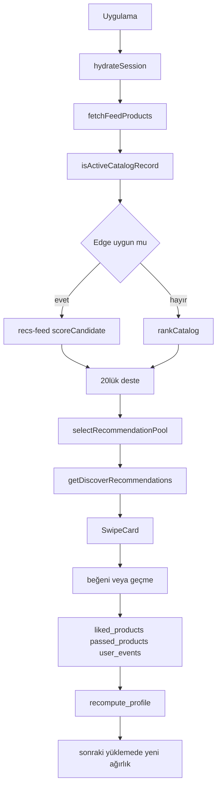

# Teknik yığın ve mimari

İstemci Expo 57 ve React Native 0.86’dır. Sıralama `lib/scoring.ts` içindedir. Kombinler `src/intelligence` altındadır. Kalıcı kullanıcı stili Supabase `user_style_profiles` satırıdır. Keşfet, profil kaydını dinlemez.

Son güncelleme: 2026-10-27

## Sürümler

`package.json` bağımlılık aralıkları. Kilit dosyası bu pakette açılmadı; çalışan sürüm `node_modules` ile kayabilir. [kodda doğrulandı: package.json]

| Parça | Aralık |
|---|---|
| expo | ^57.0.25 |
| expo-router | ~57.0.23 |
| react | 19.2.3 |
| react-native | 0.86.3 |
| typescript | ~6.0.3 |
| zustand | ^5.0.15 |
| @supabase/supabase-js | 2.45.4 |
| jest / jest-expo | ~29.7.0 / ~57.0.5 |

Stil kuralı React Native `StyleSheet`’tir. `package.json` bağımlılıklarında `nativewind` yoktur. Önceki NativeWind çelişkisi 2026-10-27’de giderildi. [kodda doğrulandı: .cursorrules; package.json]

Ortam değişkeni adları (değer yok): `EXPO_PUBLIC_SUPABASE_URL`, `EXPO_PUBLIC_SUPABASE_ANON_KEY`, `EXPO_PUBLIC_RECS_FEED_URL`, `EXPO_PUBLIC_VTON_PROXY_URL`, `EXPO_PUBLIC_PREFERENCE_V2_ENABLED`, `EXPO_PUBLIC_WARDROBE_CUTOUT_URL`, `SUPABASE_URL`, `SUPABASE_SERVICE_ROLE_KEY`. Edge `recs-feed` yalnız `SUPABASE_URL` ve `SUPABASE_SERVICE_ROLE_KEY` okur. [kodda doğrulandı: supabase/functions/recs-feed/index.ts, 330–331]

## Klasörler

| Klasör | Amaç | Ana giriş | Kim çağırır |
|---|---|---|---|
| `app/` | Ekranlar | `(tabs)/index.tsx`, `profile.tsx`, `wardrobe/*` | Expo Router |
| `store/` | Zustand dilimleri | `discoverySlice`, `favoritesSlice`, `wardrobeSlice`, `profileSlice` | Ekranlar |
| `services/` | Supabase ve cihaz I/O | `productService.fetchFeedProducts`, `likeService`, `wardrobeService`, `profileService` | Store |
| `lib/` | Sıralama, nedenler, analitik | `scoreCandidate`, `buildReasons`, `fetchStyleProfileSnapshot` | Servis ve Edge kopyası |
| `src/intelligence/` | Kombin, havuz, kullanılmayan stil bağlamı | `getDiscoverRecommendations`, `selectRecommendationPool` | Öneri önbellek servisi |
| `supabase/functions/` | Edge | `recs-feed`, `delete-account`, `account-storage-upload`, `account-storage-janitor`, `vton-proxy`, `wardrobe-cutout-control`, `premium-membership`, `revenuecat-webhook`, `vton-reconcile`, `account-storage-status` | İstemci veya zamanlama |
| `scripts/` | İçe aktarma, hazırlık, A1 betikleri | `importFeed.ts`, `seedRealCatalog.ts` | Elle `npm run` |

`src/intelligence/style/productStyle.ts` içindeki `enrichProduct` / `resolveCatalogAppearance` katalog rengini hazırlar. `buildStyleContext` ayrıdır ve canlı Keşfet’ten çağrılmaz. Ayrıntı `03`.

## Uçtan uca akış

[kodda doğrulandı: app/_layout.tsx hydrate; services/productService.ts fetchFeedProducts; src/intelligence/ranking/rankCatalog.ts; services/discoverRecommendationCacheService.ts; services/likeService.ts]

1. `hydrateSession` beğeni, geçme ve dolabı yükler. [kodda doğrulandı: store/profileSlice.ts]
2. `loadFeed` 20 ürün ister. Dışlanan kimlikler beğeni ve geçme listesidir. [kodda doğrulandı: store/discoverySlice.ts, loadFeed]
3. Giriş varsa Edge denenir. Adres `getRecsFeedUrl`: açık URL, yoksa VTON vekilinden türetme, yoksa Supabase fonksiyon adresi. Hepsi boşsa `null` ve yerel sıra. [kodda doğrulandı: services/productService.ts, 153–178]
4. Yerel ve Edge sıra `rankCandidates` / `scoreCandidate` kullanır. Ardından `rerankForDiversity`.
5. Deste başarılı olunca ayrı katalog taraması 80’lik kombin havuzunu seçer. Ekran kombin oturumunu `wardrobeItems = []` ile kurar. [kodda doğrulandı: app/(tabs)/index.tsx, 276–279]
6. Beğeni `liked_products`, geçme `passed_products`. Olay kuyruğu `ingest_events` sonrası `recompute_profile` çalıştırır. [kodda doğrulandı: supabase/recs_v1.sql, event_weights ve ingest]
7. Profil anlık görüntüsü bellekten düşer. Açık deste yerinde yeniden sıralanmaz.

Worker `scripts/lib/recommendationCacheWorker.ts` aynı kombin motorunu çalıştırır. Genel kapsama yazmak sahip doğrulaması olmadan reddedilir. [kodda doğrulandı: scripts/lib/supabaseRecommendationCache.ts, write]

## Çağrı sahipleri

| Fonksiyon | Dosya | Çağıran | Çağrılan |
|---|---|---|---|
| `loadFeed` | `store/discoverySlice.ts` | `app/(tabs)/index.tsx` | `fetchFeedProducts` |
| `fetchFeedProducts` | `services/productService.ts` | `loadFeed` | Edge veya `rankLocally` / `selectLocalFeed` |
| `rankCatalog` | `src/intelligence/ranking/rankCatalog.ts` | yerel sıra | `rankCandidates`, `rerankForDiversity` |
| `scoreCandidate` | `lib/scoring.ts` | `rankCandidates` ve Edge kopyası | ağırlık aramaları |
| `fetchStyleProfileSnapshot` | `lib/recsConfig.ts` | yerel sıra, profil sekmesi | `user_style_profiles` |
| `selectRecommendationPool` | `src/intelligence/recommendations/selectRecommendationPool.ts` | katalog yüklemesi | rol kotaları |
| `getDiscoverRecommendations` | `src/intelligence/recommendations/getDiscoverRecommendations.ts` | önbellek servisi | kombin üretici ve seçici |
| `buildReasons` | `lib/reasons.ts` | `lib/diversity.ts` | chip metni |
| `insertLikedProduct` / `insertPassedProduct` | `services/likeService.ts` | favori ve keşif dilimleri | tablo veya V2 RPC |
| `addWardrobeItem` | `store/wardrobeSlice.ts` | `app/wardrobe/add.tsx` | `saveWardrobe`, cutout |
| `upsertStudioProfile` | `services/profileService.ts` | `profile.tsx` | `profiles`, `sync_declared_style_tags` |

Edge `recs-feed` istemci `lib/scoring.ts` dosyasını import etmez. Aynı formülün kopyası `supabase/functions` altındadır. İki kopya drift edebilir. Eşitlik bu yazımda diff’lenmedi. [doğrulanamadı: bayt eşitliği]

## Hata ve boş sonuç

`feedStatus` `loading`, `success`, `error` olur. Hata kartı yenileme çağırır. Katalog biterse bitiş kartı vardır. `LOCAL_RANK_FAILED` uyarıdır; ürünler katalog sırasında kalır. [kodda doğrulandı: services/productService.ts, yerel sıra catch] Edge `null` dönerse bu bir hata durumu değildir; yerel sıra sessizce kullanılır.

Boş kombin `selectDiverseComplements` `null` ise kartın altında parça yoktur. Bu, kullanıcının “hiç önerme” hedefine kısmen uyar. Kalite eşiği yoktur. `03` ve `09`.

## Kimlik ve durum

Oturum Supabase Auth’tur. Ayrıntılı sağlayıcı listesi bu pakette açılmadı. Profil sekmesi hesap silme akışını A1 Edge’ine bağlar. O akış `06` dosyasındadır. Keşfet, silme fence’ini okumaz. Silinen hesapta açık desteğin davranışı [doğrulanamadı] bu paketin kapsamında yeniden izlenmedi.

## Yığında olmayanlar

- Ayrı bir stil paketi yok. Stil `StyleSheet` ile yazılır. NativeWind çelişkisi giderildi.
- JEV, SemanticJudgment, embedding çağrısı yok. Karar 8 uygulanmadı. `09`.
- Ayrı bir `InsightChip` bileşeni yok. Etiket `SwipeCard` içindedir.
- `evaluateCompatibility` canlı sıra veya kombin seçiminde yoktur. `03`.

Stil karışım sabitleri `lib/scoring.ts` 22–27: beyan payı 0.35, davranış payı 0.65, gürültü genliği 2, ürün negatifi 12 saat, özellik negatifi ölçeği 0.25. Trend modunda `deal_match` artışı varsayılan 3’tür; kişisel ağırlıkta `deal_match` 0’dır. [kodda doğrulandı: lib/scoring.ts, 29–58]
