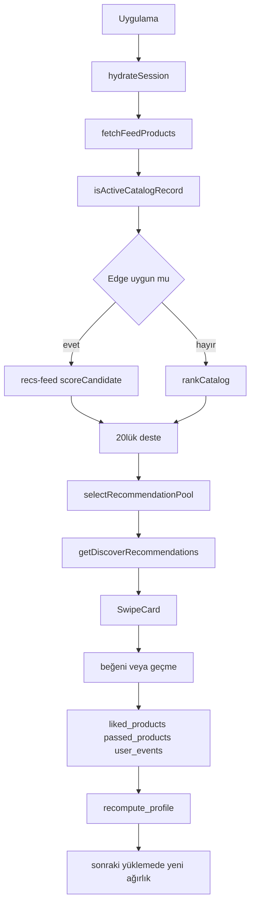

# Vitrify proje bilgi paketi

Oluşturma tarihi: 2026-10-27

Kaynak dosyalar `docs/claude-project/` altındadır. Bu birleşik dosya kaynakların kendisini içermez.

## Kaynaklar

| Dosya | Özet |
|---|---|
| [00 — 00-README.md](#bolum-00) | Paketin amacı, dosya listesi, okuma sırası ve çelişki indeksi. |
| [01 — 01-urun-ozeti.md](#bolum-01) | Vitrify dört sekmeli bir keşif uygulamasıdır; dolaptan kombin ve kanıtlı kart etiketi hedeftir, ikisi de bugün tam değildir. |
| [02 — 02-teknik-yigin-ve-mimari.md](#bolum-02) | Expo 57 / RN 0.86 istemci, Zustand ve Supabase; Keşfet sırası ile kombin motoru ayrı çağrı zincirleridir. |
| [03 — 03-style-intelligence-mevcut-durum.md](#bolum-03) | Canlı stil, scoreCandidate ve catalogCompatibility kurallarıdır; StyleContext canlı yola bağlı değildir. |
| [04 — 04-dolap-ve-kombin.md](#bolum-04) | Dolap fotoğraf, kategori ve başlık tutar; Keşfet kombin oturumuna boş dizi verir. |
| [05 — 05-katalog-ve-veri-kalitesi.md](#bolum-05) | Uygunluk kapısı renksiz ürünü eler; 2026-10-14 sayımı 496, 2026-10-27 silme sonucu 349’dur. |
| [06 — 06-backend-guvenlik-ve-A1.md](#bolum-06) | A1 fazları 4b’ye kadar çoğunlukla yerel/fake kanıttır; Faz 5 janitor zamanlaması BLOCKED’dur. |
| [07 — 07-performans-ve-onbellek.md](#bolum-07) | Katalog ve profil önbellekleri kısa ömürlüdür; profil değişimi açık desteyi yenilemez. |
| [08 — 08-test-ve-kalite.md](#bolum-08) | npm test Jest’tir; 2026-10-27 tam suit 188 PASS / 19 FAIL, tsc 0 tanıdır. |
| [09 — 09-kararlar-ADR.md](#bolum-09) | Alınmış kararlar HEDEF, KISMEN veya UYGULANDI olarak işaretlenir. |
| [10 — 10-acik-isler-ve-oncelikler.md](#bolum-10) | Önce chip’in fiyat etiketini kanıta bağlamak veya gizlemek, sonra dolap ve profil. |
| [11 — 11-calisma-kurallari.md](#bolum-11) | Görev kapsamı, A1 yasakları ve önce test, tek değişiklik, faz sonunda dur. |
| [12 — 12-sozluk.md](#bolum-12) | Çapa, kapı, abstain, fence, JEV ve insight chip tanımları. |
| [13 — 13-yol-haritasi.md](#bolum-13) | Yol haritası metni, 2026-10-27’de olduğu gibi kaydedildi. |

## İçindekiler

- [00 — 00-README.md](#bolum-00)
- [01 — 01-urun-ozeti.md](#bolum-01)
- [02 — 02-teknik-yigin-ve-mimari.md](#bolum-02)
- [03 — 03-style-intelligence-mevcut-durum.md](#bolum-03)
- [04 — 04-dolap-ve-kombin.md](#bolum-04)
- [05 — 05-katalog-ve-veri-kalitesi.md](#bolum-05)
- [06 — 06-backend-guvenlik-ve-A1.md](#bolum-06)
- [07 — 07-performans-ve-onbellek.md](#bolum-07)
- [08 — 08-test-ve-kalite.md](#bolum-08)
- [09 — 09-kararlar-ADR.md](#bolum-09)
- [10 — 10-acik-isler-ve-oncelikler.md](#bolum-10)
- [11 — 11-calisma-kurallari.md](#bolum-11)
- [12 — 12-sozluk.md](#bolum-12)
- [13 — 13-yol-haritasi.md](#bolum-13)

<a id="bolum-00"></a>

## 00 — 00-README.md

## Vitrify — Claude Project bilgi paketi

Vitrify’ın moda keşfi, dijital dolap, kombin ve stil puanlama sistemini yeni bir danışmana tek oturumda anlatmak için yazıldı. İddialar kod veya tarihli rapora bağlıdır. Bu paket kod değildir; davranışı değiştirmez.

Son güncelleme: 2026-10-27

Durum etiketleri: `[kodda doğrulandı: yol]`, `[rapora dayanıyor: yol]`, `[doğrulanamadı]`. `ÇELİŞKİ` iki kaynağın uyuşmadığı yerdedir. Anahtar, token, `.env` değeri ve kullanıcı kimliği yok. Ortam değişkenleri yalnız ad olarak geçer.

### Okuma sırası

1. [01-urun-ozeti.md](#bolum-01) — ürün, sekmeler, hedeflenen deneyim.
2. [02-teknik-yigin-ve-mimari.md](#bolum-02) — yığın, klasörler, açılıştan beğeniye akış.
3. [03-style-intelligence-mevcut-durum.md](#bolum-03) — sıralama, kombin, bağlı olmayan stil katmanı, insight chip.
4. [04-dolap-ve-kombin.md](#bolum-04) — dolap modeli, kesim, senkron, Keşfet’in boş dolap dizisi.
5. [05-katalog-ve-veri-kalitesi.md](#bolum-05) — şema, uygunluk kapısı, başlık çıkarımı, sayılar.
6. [06-backend-guvenlik-ve-A1.md](#bolum-06) — Supabase, Edge, hesap silme fazları, açık güvenlik.
7. [07-performans-ve-onbellek.md](#bolum-07) — önbellekler ve ölçülmüş / ölçülmemiş performans.
8. [08-test-ve-kalite.md](#bolum-08) — komutlar, kapsam, kırık testler.
9. [09-kararlar-ADR.md](#bolum-09) — alınmış kararlar ve kodda durumları.
10. [10-acik-isler-ve-oncelikler.md](#bolum-10) — P0–P5 ve kodda görülen ek işler.
11. [11-calisma-kurallari.md](#bolum-11) — `AGENTS.md` ve geliştirme kuralları.
12. [12-sozluk.md](#bolum-12) — terimler.
13. [13-yol-haritasi.md](#bolum-13) — yol haritası metni, olduğu gibi.

### Dosya özetleri

| Dosya | Bir cümle |
|---|---|
| 01 | Vitrify dört sekmeli bir keşif uygulamasıdır; dolaptan kombin ve kanıtlı kart etiketi hedeftir, ikisi de bugün tam değildir. |
| 02 | Expo 57 / RN 0.86 istemci, Zustand ve Supabase; Keşfet sırası ile kombin motoru ayrı çağrı zincirleridir. |
| 03 | Canlı stil, `scoreCandidate` ve `catalogCompatibility` kurallarıdır; `StyleContext` canlı yola bağlı değildir. |
| 04 | Dolap fotoğraf, kategori ve başlık tutar; Keşfet kombin oturumuna boş dizi verir. |
| 05 | Uygunluk kapısı renksiz ürünü eler; 2026-10-14 sayımı 496, 2026-10-27 silme sonucu 349’dur. |
| 06 | A1 fazları 4b’ye kadar çoğunlukla yerel/fake kanıttır; Faz 5 janitor zamanlaması BLOCKED’dur. |
| 07 | Katalog ve profil önbellekleri kısa ömürlüdür; profil değişimi açık desteyi yenilemez. |
| 08 | `npm test` Jest’tir; üç `feedPagination` testi Edge’e hiç çıkmadan düşer. |
| 09 | Kararların bir kısmı uygulanmış, uyum modülü ve StyleContext kararları uygulanmamıştır. |
| 10 | Önce chip’in fiyat etiketini kanıta bağlamak veya gizlemek, sonra dolap ve profil. |
| 11 | Görev kapsamı, A1 yasakları ve “önce test, tek değişiklik, faz sonunda dur”. |
| 12 | Çapa, kapı, abstain, fence, JEV ve insight chip tanımları. |
| 13 | Yol haritası metni, 2026-10-27’de olduğu gibi kaydedildi. |

Bu paket 2026-10-27’de çalışma ağacından üretildi. Canlı veritabanı bu yazım sırasında yeniden okunmadı.

### Nasıl kullanılmalı

Her dosya kendi özetiyle başlar. Danışman bir sohbette yalnız ilgili dosyayı okusa da terim ve tarih orada durur. Çelişki başka dosyada geçse bile kısa hali bulunduğu dosyada tekrarlanır.

Güncelleme kuralı: kod değişince ilgili dosyanın “Son güncelleme” satırı ve durum etiketi değişir. Eski raporu silmek yerine tarih eklenir. Canlı sayım yazılacaksa sorgu bu pakette yoktur; sayıyı yazan kişi rapor yolunu ekler.

### Bu paketin bilerek yazmadığı şeyler

- `.env` değerleri, servis anahtarları, JWT, e-posta, kullanıcı UUID’si.
- “Kapalı beta”nın mağaza kaydı. Repo metninde geçmiyor. [doğrulanamadı]
- JEV’in sözleşme metni. Kodda çağrı yok. [doğrulanamadı]
- Yayındaki Edge gövdesinin kaynakla aynı olduğu. [doğrulanamadı]
- 2026-10-27 akşamındaki canlı ürün ve önbellek sayısının hâlâ 349 ve 0 olduğu. O gün görüldü; bu yazımda yeniden okunmadı.

### Çelişki indeksi

Ayrıntı ilgili dosyadadır. Kısa liste:

- NativeWind çelişkisi 2026-10-27’de giderildi. Stil `StyleSheet`. [02](#bolum-02)
- Kök ürün CHECK’i backend açık işidir; yeni kurulumda güncel sağlayıcı reddedilir. [05](#bolum-05), [10](#bolum-10)
- “Fiyat aralığına uygun” öğrenilmiş banttır, beyan edilen bütçe değildir. [03](#bolum-03)
- Dolap tabloları 10 Ekim yok, 13 Ekim kurulum raporu var. [04](#bolum-04)
- `dolap_remove` ağırlığı var, istemci olayı yok. [04](#bolum-04)
- Karar 4, 5 ve 7 hedef ile mevcut kod farkıdır; çelişki değildir. [09](#bolum-09)
- tsc 63 / 1 / 0 üç eski 2026-10 raporudur. Bugünkü sayı [08](#bolum-08) baseline’ındadır.
- I3 operasyon temizliği 2026-10-27’de eklendi. Önceki purge farkı giderildi. [06](#bolum-06)
- `dolap_add` üç yazıcıda geçer: dolap fotoğrafı, favori ve deneme. Üçü aynı sahiplik değildir. [04](#bolum-04)

### Kod yazmadan önce yeniden bak

Paket 2026-10-27 anıdır. Danışman şu maddeleri “hâlâ böyle” diye devralmasın; ürün sahibi veya yeni bir salt okuma söylemeden güncel sayılmasın:

- Canlı `products` ve `discover_recommendation_cache` satır sayısı. Son görülen 349 ve 0’dır. Bu yazımda yeniden sayılmadı. [doğrulanamadı]
- `wardrobe_items` / `outfits` / `outfit_items` canlıda duruyor mu. 13 Ekim kurulum raporu var. [doğrulanamadı]
- Kota EXECUTE ve istemci idari grant’leri. 10 Ekim ölçümü. [doğrulanamadı]
- Yayındaki `recs-feed` ve `delete-account` gövdesi kaynakla aynı mı. [doğrulanamadı]
- `npx tsc --noEmit` hata sayısı. Bu oturumda çalıştırılmadı. [doğrulanamadı]
- Tam Jest sonucu. Yalnız üç `feedPagination` testi 2026-10-27’de yeniden koştu ve FAIL oldu.

Sır yok: bu klasörde JWT, servis anahtarı, `postgres://` bağlantısı, e-posta ve proje referansı arandı. Bulunan olursa dosyadan çıkarılır; değer yazılmaz.

### Danışman hangi dosyayı açar

| Soru | Dosya |
|---|---|
| Karttaki etiket neden “bütçe” gibi duruyor? | [03](#bolum-03), sonra [01](#bolum-01) hedef tablosu |
| Dolap neden kombine girmiyor? | [04](#bolum-04) |
| Renksiz ürün neden destede yok? | [05](#bolum-05) |
| Hesap silme staging’de bitti mi? | [06](#bolum-06) |
| Profil kaydı desteyi neden yenilemiyor? | [07](#bolum-07) |
| Üç kırmızı Jest neyi kanıtlamaz? | [08](#bolum-08) |
| Karar uygulanmış mı? | [09](#bolum-09) |
| Sıradaki iş | [10](#bolum-10) |

Bir dosya başka dosyaya “ayrıntı orada” diyebilir. Yine de kendi cümlesi durum etiketi taşır. Canlı sayı yazan cümle, tarih ve rapor yolu olmadan güncel kabul edilmez.

Okuma sırası 01’den 12’ye kadardır. Çelişki indeksindeki madde, ilgili dosyada ikinci kez ve kanıt yoluyla durur. Bu klasör dışında dosya değişmedi.

---

<a id="bolum-01"></a>

## 01 — 01-urun-ozeti.md

## Ürün özeti

Vitrify, mağaza ürünlerini kart kart gezdiren, beğenilenleri saklayan ve kullanıcının kendi kıyafetlerini dolaba almasını hedefleyen bir mobil moda uygulamasıdır. Bugün çalışan çekirdek Keşfet sırası, beğeni/geçme ve katalog kombinleridir. Dolaptan tamamlayıcı kombin ve kanıtlı tek etiket henüz ürün hedefidir.

Son güncelleme: 2026-10-27

### Ne var

Dört sekme `app/(tabs)/_layout.tsx` içindedir. [kodda doğrulandı: app/(tabs)/_layout.tsx, 70–97]

| Sekme | Dosya | Bugünkü iş |
|---|---|---|
| Keşfet | `app/(tabs)/index.tsx` | Ürün destesi, kaydırma, kart altı katalog kombinleri |
| Favoriler | `app/(tabs)/style.tsx` | Beğenilen ürünler. Stil anketi burada değildir |
| Dolap | `app/(tabs)/liked.tsx` | Dolap ve kayıtlı kombinlere giriş |
| Profil | `app/(tabs)/profile.tsx` | Hesap, beden/stil stüdyosu, hesap silme |

Dolap ekleme `app/wardrobe/add.tsx`, kombin kurma `app/wardrobe/create.tsx` altındadır. [kodda doğrulandı: app/wardrobe/add.tsx]

“Kapalı beta” ifadesi repo Markdown’ında bulunamadı. [doğrulanamadı] Ürün sahibi bu paketi kapalı beta danışmanlığı için istedi; bu bir kod olgusu değil, paket amacıdır.

### Hedeflenen deneyim

Bunlar ürün sahibinin istekleridir. Kodda karşılığı varsa ayrıca işaretlenir.

- Kullanıcı kıyafetini dolaba yükler. Style Intelligence, dolaptaki parçalarla tamamlayıcı kombin önerir. Motor dolap öğesi kabul eder; Keşfet ekranı bugün boş dizi verir. Ayrıntı [04-dolap-ve-kombin.md](#bolum-04).
- Keşfet kartının üstündeki etiket, gerçek kanıt varsa tek bir cümle söyler. Örnekler: “Dolabındaki lacivert jeanle uyumlu”, “Dolabındaki 3 parçayla kombinlenir”, “Beğendiğin minimal parçalara benziyor”, “Bütçene uygun”, “Son 30 günün en düşük fiyatı”, “Yeni bir tarz denemesi”. Kanıt yoksa etiket yoktur. Kart başına en fazla bir etiket.
- Bugün görünen etiket bu listenin tamamı değildir. Metin `buildReasons` üretir; ilk neden `product.reason` olur; `SwipeCard` bunu Sparkles ikonuyla çizer. “Fiyat aralığına uygun”, öğrenilen fiyat bandı eşiğini geçerse çıkar. Beyan edilen bütçe alanı bu etiketi beslemez. Ayrıntı [03-style-intelligence-mevcut-durum.md](#bolum-03).
- Sparkles yerine, Vitrify görünümüne uygun soyut “iki nokta göz” animasyonu hedeflenir: ilk görünüşte bir kez kırpar, dolap eşleşmesinde o parçaya kısaca bakar, döngüye girmez, azaltılmış harekete uyar. Bu animasyon kodda yok. [doğrulanamadı]
- Stil profili tek bir “%X tanıyoruz” yüzdesi olmamalı. Her içgörü “henüz bilinmiyor / oluşuyor / belirgin” ve kanıt taşır. Beğeniler gösterim sayısına bölünür. Bu durum modeli canlı profil ekranında yok. [doğrulanamadı]
- Beğeni ve geçme sonraki sıralamayı tutarlı değiştirmeli. Profil ekranı ile motor aynı `user_style_profiles` satırını okumalı; profil ekranı ağırlığı istemcide yeniden yorumlamamalı. V2 bayrağı açıkken profil kartları backend ağırlığını kullanır. Keşfet, kayıt anında desteyi yenilemez. Ayrıntı [03](#bolum-03) ve [09](#bolum-09).

### Bugün kullanıcı ne yaşar

Misafir kişiselleştirilmiş sıra almaz. Girişli kullanıcı destede ürün görür, beğenir veya geçer. Beğenilen katalog ürünü favorilere yazılır. Geçilen bir daha aynı destede gösterilmez. Kartın altında, ayrı bir 80 ürünlük havuzdan katalog kombinleri gelebilir. Dolaba fotoğraf eklemek o kombinleri değiştirmez.

Stil stüdyosu etiket, beden, marka, renk ve bütçe sorar. Sırayı doğrudan değiştiren beyan, stil etiketlerinin `style_tag_weights` alanına yazılmasıdır. Marka, renk ve bütçe auth metadata’sında kalır ve `scoreCandidate` bunları okumaz. [kodda doğrulandı: lib/scoring.ts, scoreCandidate 367–478; components/SizeStudioSheet.tsx]

### Bir oturum, bugünkü haliyle

1. Uygulama açılır. Giriş varsa `app/_layout.tsx` `hydrateSession` çağırır. Beğeniler, geçilenler ve dolap gelir. [kodda doğrulandı: store/profileSlice.ts]
2. Keşfet, oturum hazır olunca `loadFeed` ister. Misafir kişiselleştirilmiş Edge sırasına girmez.
3. Kartta görsel, marka, fiyat ve varsa tek neden etiketi vardır. Etiket yoksa chip çizilmez. [kodda doğrulandı: components/SwipeCard.tsx, 750–756]
4. Beğeni çift dokunuşla, geçme kaydırmayla yazılır. Geçilen kimlik sonraki sayfadan düşer. Açık deste yerinde yeniden puanlanmaz.
5. Kartın altındaki kombin, ayrı 80’lik katalog havuzundandır. Dolap parçası bu havuza bugün girmez.
6. Profilde stil etiketi kaydı ağırlık önbelleğini düşürür. Kullanıcı desteyi yenilemezse eski sıra kalır.

### Hedef ile bugün arasındaki fark

| Hedef cümle | Bugün |
|---|---|
| Dolaptaki jeanle uyumlu | Metin `buildReasons` içinde yok. Dolap kombin girdisi boş. |
| Dolabındaki 3 parçayla kombinlenir | Yok. |
| Beğendiğin minimal parçalara benziyor | Yok. “Minimal stiline yakın” yalnız etiket ağırlığı `minimal` ise çıkar. |
| Bütçene uygun | Yok. Görünen “Fiyat aralığına uygun” öğrenilmiş banttır. |
| Son 30 günün en düşük fiyatı | Bu cümle `buildReasons` içinde yok. İndirim skoru `deal_match` varsayılanda 0. |
| Yeni bir tarz denemesi | Keşif yuvasında “Yeni bir şey dene” vardır. Dolap kanıtı değildir. |
| Kanıt yoksa etiket yok | Eşik altı katkı elenir. Eşik, bütçe kanıtı değildir. |
| Kart başına bir etiket | `buildReasons` iki etiket üretebilir; karta yalnız `reasons[0]` yazılır. |
| İki nokta göz | Sparkles ikonu. Animasyon yok. |

Durumlar [03](#bolum-03) dosyasında satırla bağlıdır. Bu tablo ürün farkını göstermek içindir.

### Dosya adı ile sekme adı

Sekme başlığı ile dosya adı aynı değildir. [kodda doğrulandı: app/(tabs)/_layout.tsx, 70–97]

| Başlık | Route dosyası | İkon |
|---|---|---|
| Keşfet | `app/(tabs)/index.tsx` | Compass |
| Favoriler | `app/(tabs)/style.tsx` | Heart |
| Dolap | `app/(tabs)/liked.tsx` | Shirt |
| Profil | `app/(tabs)/profile.tsx` | User |

`style.tsx` stil anketi değildir. Anket `SizeStudioSheet` ile profil akışındadır. `liked.tsx` beğeni listesi değildir; beğeniler Favoriler sekmesindedir. Dolap fotoğrafı `WardrobeItem`’dır. Beğenilen mağaza ürünü `liked_products` satırıdır.

### “Dolaba ekle” üç ayrı iş

Olay adı `dolap_add` üç yerde yazılır. Yalnız dolap formu fotoğraf ekler. Diğer ikisi katalog beğenisidir.

- Dolap formu, başarılı senkron sonrası fotoğraf kimliği ve `source: 'wardrobe'` yazar. [kodda doğrulandı: store/wardrobeSlice.ts, 333]
- Favori, aynı katalog kimliği için `like` ve `dolap_add` (`source: 'feed'`) yazar. Bu, `insertLikedProduct` yoludur. [kodda doğrulandı: store/favoritesSlice.ts, 112–118]
- Deneme penceresi “Dolabına eklendi” der ve yine `insertLikedProduct` çağırır; olay `source: 'tryon'`. [kodda doğrulandı: components/VirtualTryOnModal.tsx, 705–710]

`analyzePreferenceEvents` favori kökenli `like` + `dolap_add` çiftini tek tercih sayar ve bunu dolap sahipliği saymaz. Fonksiyon puan yazmaz. Üretim importu yalnız testtedir. [kodda doğrulandı: src/intelligence/evidence/sharedEvidence.ts, 227–231; __tests__/preferenceActionEvidence.test.ts]

### Misafir

Giriş yoksa `fetchFeedProducts` Edge ve `rankLocally` çağırmaz. `selectLocalFeed` katalog sayfasından seçer ve `isPersonalized: false` döner. [kodda doğrulandı: services/productService.ts, 568–577; seçici `src/intelligence/recommendations/feedFallback.ts`] Misafirin dolap yazma sınırı bu pakette satır satır izlenmedi. [doğrulanamadı: misafir dolap sınırı]

### Ürün sahibinin istediği deneyim, kod değil

Yukarıdaki hedef listesi istek metnidir. “%X tanıyoruz” yüzdesinin ekranda olup olmadığı bu yazımda profil bileşeninde ayrıca aranmadı; durum modeli diye ayrı bir tip bulunamadı. [doğrulanamadı] Göz animasyonu ve “dolabındaki jean” cümlesi `buildReasons` ve `SwipeCard` içinde yoktur. [kodda doğrulandı: lib/reasons.ts; components/SwipeCard.tsx, 750–756]

Dört sekme birincil gezintidir. Kombin kurma ve dolap ekleme sekme değil, `app/wardrobe/` altındaki ekranlardır. Favori sekmesi mağaza beğenisini listeler. Dolap sekmesi fotoğraf öğesini listeler. İkisi aynı tablo değildir.

Kart başına bir etiket hedefi, bugünkü `reasons[0]` atamasıyla kısmen örtüşür. İkinci neden üretilse de çizilmez. Bu, kanıt seçicisi değildir. Hangi cümlenin daha doğru olduğu `buildReasons` içindeki katkı sırasına kalır. [kodda doğrulandı: lib/reasons.ts, MAX_REASONS; services/productService.ts, 492]

Sekme geçişi `useReducedMotion` okur. [kodda doğrulandı: app/(tabs)/_layout.tsx, 18 ve 63] `SwipeCard` içindeki Sparkles bu ayarı okumaz. Göz animasyonu yoktur. [kodda doğrulandı: components/SwipeCard.tsx, 752]

Giriş ekranı da `AccessibilityInfo.isReduceMotionEnabled` okur. [kodda doğrulandı: app/auth.tsx, 85–90] Bu, kart etiketinin animasyonu değildir.

---

<a id="bolum-02"></a>

## 02 — 02-teknik-yigin-ve-mimari.md

## Teknik yığın ve mimari

İstemci Expo 57 ve React Native 0.86’dır. Sıralama `lib/scoring.ts` içindedir. Kombinler `src/intelligence` altındadır. Kalıcı kullanıcı stili Supabase `user_style_profiles` satırıdır. Keşfet, profil kaydını dinlemez.

Son güncelleme: 2026-10-27

### Sürümler

`package.json` bağımlılık aralıkları. Kilit dosyası bu pakette açılmadı; çalışan sürüm `node_modules` ile kayabilir. [kodda doğrulandı: package.json]

| Parça | Aralık |
|---|---|
| expo | ^57.0.25 |
| expo-router | ~57.0.23 |
| react | 19.2.3 |
| react-native | 0.86.3 |
| typescript | ~6.0.3 |
| zustand | ^5.0.15 |
| @supabase/supabase-js | 2.45.4 |
| jest / jest-expo | ~29.7.0 / ~57.0.5 |

Stil kuralı React Native `StyleSheet`’tir. `package.json` bağımlılıklarında `nativewind` yoktur. Önceki NativeWind çelişkisi 2026-10-27’de giderildi. [kodda doğrulandı: .cursorrules; package.json]

Ortam değişkeni adları (değer yok): `EXPO_PUBLIC_SUPABASE_URL`, `EXPO_PUBLIC_SUPABASE_ANON_KEY`, `EXPO_PUBLIC_RECS_FEED_URL`, `EXPO_PUBLIC_VTON_PROXY_URL`, `EXPO_PUBLIC_PREFERENCE_V2_ENABLED`, `EXPO_PUBLIC_WARDROBE_CUTOUT_URL`, `SUPABASE_URL`, `SUPABASE_SERVICE_ROLE_KEY`. Edge `recs-feed` yalnız `SUPABASE_URL` ve `SUPABASE_SERVICE_ROLE_KEY` okur. [kodda doğrulandı: supabase/functions/recs-feed/index.ts, 330–331]

### Klasörler

| Klasör | Amaç | Ana giriş | Kim çağırır |
|---|---|---|---|
| `app/` | Ekranlar | `(tabs)/index.tsx`, `profile.tsx`, `wardrobe/*` | Expo Router |
| `store/` | Zustand dilimleri | `discoverySlice`, `favoritesSlice`, `wardrobeSlice`, `profileSlice` | Ekranlar |
| `services/` | Supabase ve cihaz I/O | `productService.fetchFeedProducts`, `likeService`, `wardrobeService`, `profileService` | Store |
| `lib/` | Sıralama, nedenler, analitik | `scoreCandidate`, `buildReasons`, `fetchStyleProfileSnapshot` | Servis ve Edge kopyası |
| `src/intelligence/` | Kombin, havuz, kullanılmayan stil bağlamı | `getDiscoverRecommendations`, `selectRecommendationPool` | Öneri önbellek servisi |
| `supabase/functions/` | Edge | `recs-feed`, `delete-account`, `account-storage-upload`, `account-storage-janitor`, `vton-proxy`, `wardrobe-cutout-control`, `premium-membership`, `revenuecat-webhook`, `vton-reconcile`, `account-storage-status` | İstemci veya zamanlama |
| `scripts/` | İçe aktarma, hazırlık, A1 betikleri | `importFeed.ts`, `seedRealCatalog.ts` | Elle `npm run` |

`src/intelligence/style/productStyle.ts` içindeki `enrichProduct` / `resolveCatalogAppearance` katalog rengini hazırlar. `buildStyleContext` ayrıdır ve canlı Keşfet’ten çağrılmaz. Ayrıntı [03](#bolum-03).

### Uçtan uca akış



[kodda doğrulandı: app/_layout.tsx hydrate; services/productService.ts fetchFeedProducts; src/intelligence/ranking/rankCatalog.ts; services/discoverRecommendationCacheService.ts; services/likeService.ts]

1. `hydrateSession` beğeni, geçme ve dolabı yükler. [kodda doğrulandı: store/profileSlice.ts]
2. `loadFeed` 20 ürün ister. Dışlanan kimlikler beğeni ve geçme listesidir. [kodda doğrulandı: store/discoverySlice.ts, loadFeed]
3. Giriş varsa Edge denenir. Adres `getRecsFeedUrl`: açık URL, yoksa VTON vekilinden türetme, yoksa Supabase fonksiyon adresi. Hepsi boşsa `null` ve yerel sıra. [kodda doğrulandı: services/productService.ts, 153–178]
4. Yerel ve Edge sıra `rankCandidates` / `scoreCandidate` kullanır. Ardından `rerankForDiversity`.
5. Deste başarılı olunca ayrı katalog taraması 80’lik kombin havuzunu seçer. Ekran kombin oturumunu `wardrobeItems = []` ile kurar. [kodda doğrulandı: app/(tabs)/index.tsx, 276–279]
6. Beğeni `liked_products`, geçme `passed_products`. Olay kuyruğu `ingest_events` sonrası `recompute_profile` çalıştırır. [kodda doğrulandı: supabase/recs_v1.sql, event_weights ve ingest]
7. Profil anlık görüntüsü bellekten düşer. Açık deste yerinde yeniden sıralanmaz.

Worker `scripts/lib/recommendationCacheWorker.ts` aynı kombin motorunu çalıştırır. Genel kapsama yazmak sahip doğrulaması olmadan reddedilir. [kodda doğrulandı: scripts/lib/supabaseRecommendationCache.ts, write]

### Çağrı sahipleri

| Fonksiyon | Dosya | Çağıran | Çağrılan |
|---|---|---|---|
| `loadFeed` | `store/discoverySlice.ts` | `app/(tabs)/index.tsx` | `fetchFeedProducts` |
| `fetchFeedProducts` | `services/productService.ts` | `loadFeed` | Edge veya `rankLocally` / `selectLocalFeed` |
| `rankCatalog` | `src/intelligence/ranking/rankCatalog.ts` | yerel sıra | `rankCandidates`, `rerankForDiversity` |
| `scoreCandidate` | `lib/scoring.ts` | `rankCandidates` ve Edge kopyası | ağırlık aramaları |
| `fetchStyleProfileSnapshot` | `lib/recsConfig.ts` | yerel sıra, profil sekmesi | `user_style_profiles` |
| `selectRecommendationPool` | `src/intelligence/recommendations/selectRecommendationPool.ts` | katalog yüklemesi | rol kotaları |
| `getDiscoverRecommendations` | `src/intelligence/recommendations/getDiscoverRecommendations.ts` | önbellek servisi | kombin üretici ve seçici |
| `buildReasons` | `lib/reasons.ts` | `lib/diversity.ts` | chip metni |
| `insertLikedProduct` / `insertPassedProduct` | `services/likeService.ts` | favori ve keşif dilimleri | tablo veya V2 RPC |
| `addWardrobeItem` | `store/wardrobeSlice.ts` | `app/wardrobe/add.tsx` | `saveWardrobe`, cutout |
| `upsertStudioProfile` | `services/profileService.ts` | `profile.tsx` | `profiles`, `sync_declared_style_tags` |

Edge `recs-feed` istemci `lib/scoring.ts` dosyasını import etmez. Aynı formülün kopyası `supabase/functions` altındadır. İki kopya drift edebilir. Eşitlik bu yazımda diff’lenmedi. [doğrulanamadı: bayt eşitliği]

### Hata ve boş sonuç

`feedStatus` `loading`, `success`, `error` olur. Hata kartı yenileme çağırır. Katalog biterse bitiş kartı vardır. `LOCAL_RANK_FAILED` uyarıdır; ürünler katalog sırasında kalır. [kodda doğrulandı: services/productService.ts, yerel sıra catch] Edge `null` dönerse bu bir hata durumu değildir; yerel sıra sessizce kullanılır.

Boş kombin `selectDiverseComplements` `null` ise kartın altında parça yoktur. Bu, kullanıcının “hiç önerme” hedefine kısmen uyar. Kalite eşiği yoktur. [03](#bolum-03) ve [09](#bolum-09).

### Kimlik ve durum

Oturum Supabase Auth’tur. Ayrıntılı sağlayıcı listesi bu pakette açılmadı. Profil sekmesi hesap silme akışını A1 Edge’ine bağlar. O akış [06](#bolum-06) dosyasındadır. Keşfet, silme fence’ini okumaz. Silinen hesapta açık desteğin davranışı [doğrulanamadı] bu paketin kapsamında yeniden izlenmedi.

### Yığında olmayanlar

- Ayrı bir stil paketi yok. Stil `StyleSheet` ile yazılır. NativeWind çelişkisi giderildi.
- JEV, SemanticJudgment, embedding çağrısı yok. Karar 8 uygulanmadı. [09](#bolum-09).
- Ayrı bir `InsightChip` bileşeni yok. Etiket `SwipeCard` içindedir.
- `evaluateCompatibility` canlı sıra veya kombin seçiminde yoktur. [03](#bolum-03).

Stil karışım sabitleri `lib/scoring.ts` 22–27: beyan payı 0.35, davranış payı 0.65, gürültü genliği 2, ürün negatifi 12 saat, özellik negatifi ölçeği 0.25. Trend modunda `deal_match` artışı varsayılan 3’tür; kişisel ağırlıkta `deal_match` 0’dır. [kodda doğrulandı: lib/scoring.ts, 29–58]

---

<a id="bolum-03"></a>

## 03 — 03-style-intelligence-mevcut-durum.md

## Style Intelligence — mevcut durum

Ayrı bir Style Intelligence servisi yok. Canlı karar iki kural motorudur: Keşfet sırası `scoreCandidate`, kart kombinleri `catalogCompatibility`. `buildStyleContext` ve `evaluateCompatibility` testlerde durur, ekrandan çağrılmaz.

Son güncelleme: 2026-10-27

### Keşfet sırası

`rankCatalog` adayları niyetteki kategori ve cinsiyete göre süzer, `toScoringCandidate` ile puanlar, `rerankForDiversity` ile dizer. [kodda doğrulandı: src/intelligence/ranking/rankCatalog.ts, 12–41]

`toScoringCandidate` renk, alt tür, kalıp, marka slug’ı ve fiyat bandını üründen ya da `preparedProductAttributes` başlık çıkarımından alır. `style_tags` okunmaz. [kodda doğrulandı: src/intelligence/ranking/productCandidate.ts, 5–26]

Varsayılan ağırlıklar `lib/scoring.ts` 29–42: kategori 10, stil 8, renk 6, marka 5, kalıp 6, fiyat bandı 4, negatif 8, yenilik 3, tazelik 2, oturum 9, deneme alt türü 4, indirim 0. Stil karışımı beyan 0.35, davranış 0.65. Gürültü genliği 2.

`scoreCandidate` (367–478) özü:

- Uzun vadeli afinite: `colorW`, `fitW`, `subcategoryW` (alt tür veya kategori), `brandW`, `priceBandW`.
- Stil: etiket öncelikleri (`DEFAULT_STYLE_TAG_PRIORS`) ile davranış ortalamasının karışımı.
- Oturum: `buildIntent` ağırlıkları. Arama metni marka veya alt türde geçiyorsa oturum afinitesine +0.45.
- Tazelik 90 gün. Yenilik gösterim sayısından. Son denenen alt tür eşleşirse 1.
- Yumuşak negatif: aynı ürün 12 saat yarı ömür; yoksa renk/alt tür/kalıp/marka, ölçek 0.25.
- Toplam = ağırlıklı taban + oturum + tazelik + yenilik + deneme + indirim − negatif + günlük gürültü.

Trend modu `applyFeedMode` ile tazelik ve indirimi büyütür. Misafir bu fonksiyona girmez; `selectLocalFeed` kullanılır.

Eşikler `reasonsThresholds`: fiyat 0.2, renk 0.25, stil ve kategori 0.3, marka 0.35. [kodda doğrulandı: lib/scoring.ts, 112–120]

### Profil ve olaylar

`user_style_profiles` ağırlık haritaları ve `negative_preferences` tutar. Okuma `fetchStyleProfileSnapshot`. [kodda doğrulandı: lib/recsConfig.ts]

`sync_declared_style_tags` yalnız `style_tag_weights` günceller. [kodda doğrulandı: supabase/recs_v1_p1.sql] Çağrı `profileService.syncDeclaredStyleTags`.

`recompute_profile` son 1000 olayı, `product_attributes` ile birleştirir. Olay ağırlığının mutlak değeri 0.5’in altındaysa döngüye girmez. Varsayılanlar: impression 0.05, like 1, dolap_add 1.2, share 1.5, try_on_start 1.5, try_on_success 2, store_click 3, pass −0.8, dolap_remove −1. [kodda doğrulandı: supabase/recs_v1.sql, 103–114 ve 492–511]

Gösterim profil ağırlığına girmez; yalnız `noveltyScore` için sayılır. Arama ve filtre olayları profil anlığını düşürmez. [kodda doğrulandı: lib/analytics.ts, invalidate koşulu]

V2 (`EXPO_PUBLIC_PREFERENCE_V2_ENABLED`) istemcide `preferenceTransactionAdapter` ve `style_apply_preference_v2` yolunu seçer. SQL önerisi `reports/backend/proposals/` altındadır. Canlı kurulum bu paket yazılırken yeniden okunmadı. [doğrulanamadı] Özet: [rapora dayanıyor: reports/release/VITRIFY_V1_STYLE_INTELLIGENCE_INTEGRATION.md]

### Kombin motoru

`getDiscoverRecommendations` filtre ve cinsiyet uyumundan sonra `generateOutfitCandidates`, `rankOutfitCandidates` veya çeşitlilik yolu, sonra `selectDiverseComplements` çağırır. [kodda doğrulandı: src/intelligence/recommendations/getDiscoverRecommendations.ts, 53–68]

`catalogCompatibility` (`src/intelligence/outfits/catalogCompatibility.ts` 14–50): renk 0 / 0.5 / 1 ağırlık 0.30; aynı marka (Kabin sayılmaz) 0.10; aynı kalıp 0.10; aynı stil sınıfı 0.15; fiyat skora 0. Üst sınır 0.65. Stil sınıfı yalnız jean, tişört, polo, hoodie, sweatshirt, sneaker, şort → casual; blazer, gömlek → tailored. Diğer alt türler 0 stil puanı alır ve elenmez.

`selectRecommendationPool` en fazla 80 ürün, isteğe bağlı rolde en fazla 4 koltuk, sağlayıcı sırası. Profil, renk ve cinsiyet havuzu seçmez. [kodda doğrulandı: src/intelligence/recommendations/selectRecommendationPool.ts, 3–12]

`selectDiverseComplements` en fazla 3 parça seçer. Aday kalmazsa döngü erken biter; hiç kombin yoksa `null`. Bu, “kalitesizse gösterme” eşiği değildir: en iyi aday marjın içindeyse düşük mutlak skor da seçilebilir. [kodda doğrulandı: src/intelligence/recommendations/selectDiverseComplements.ts, 15–31 ve 76–88]

### Bağlı olmayan modüller

| Modül | Dosya | Canlı çağrı | Test |
|---|---|---|---|
| `buildUserSnapshot` | `src/intelligence/user/userSnapshot.ts` | `app/` ve `services/` altında yok | `userSnapshot.test.ts` |
| `buildStyleContext` | `src/intelligence/style/styleContext.ts` | Yok; yalnız kapı modülü import eder | `styleContext.test.ts` |
| `buildProductIntelligence` | `src/intelligence/product/productIntelligence.ts` | Keşfet sırasına girmez | `productIntelligence.test.ts` |
| `evaluateCompatibility` | `src/intelligence/compatibility/compatibilityGate.ts` | Üretim importu yok | `compatibilityGate.test.ts` |

Test, kapının üretim dosyalarınca import edilmemesini kilitler. [kodda doğrulandı: __tests__/compatibilityGate.test.ts]

### Bağlantı matrisi

| Veri | Karar | Durum |
|---|---|---|
| `style_tag_weights` | Keşfet stil afinitesi ve “Minimal stiline yakın” | Girer |
| `colorW` `fitW` `subcategoryW` `brandW` `priceBandW` | Keşfet puanı ve chip | Girer |
| Geçilen ürün kimliği | Desteden eleme ve yumuşak negatif | Girer |
| Oturum beğenisi ve arama | Sonraki istekteki `buildIntent` | Girer |
| Beyan edilen marka, renk, bütçe (`studio_preferences`) | Puan | Girmez |
| Beden / boy / kilo | Puan | Girmez |
| Dolap öğeleri | Keşfet kombin girdisi | Girmez; ekran `[]` verir |
| Kaydedilen kombinler | Sonraki öneri | Girmez |
| `dolap_add` katalog kimliği | Nitelik satırı varsa profil | Dolaylı |
| `dolap_add` dolap UUID’si | Renk öğrenmesi | Nitelik satırı beklenmez |
| `dolap_remove` | Profil | Olay tipi var, `track('dolap_remove')` yok |
| Gösterim | Yenilik puanı | Girer; profil ağırlığına girmez |

### Insight chip

Bileşen ayrı bir `InsightChip` değildir. `SwipeCard` `product.reason` doluysa Sparkles (lucide) ve tek satır metin çizer. [kodda doğrulandı: components/SwipeCard.tsx, 630 ve 750–756]

Metin UI’da üretilmez. `types/product.ts` 82: `reason`, `recs-feed` `reasons[0]`; yoksa chip yok. Atama `productService.ts` 492: `metadata.reasons[0]`. `buildReasons` en fazla iki etiket üretir (`MAX_REASONS = 2`) ama karta yalnız ilki yazılır. [kodda doğrulandı: lib/reasons.ts, 9 ve 56–137]

“Fiyat aralığına uygun” kesinleşmesi:

- Bileşen: ayrı chip yok. `SwipeCard` `product.reason` doluysa Sparkles ve tek satır çizer. Metni `buildReasons` üretir; karta `metadata.reasons[0]` yazılır. [kodda doğrulandı: components/SwipeCard.tsx, 750–756; services/productService.ts, 492; lib/reasons.ts, 100–107]
- Alan: `profile.priceBandW` içinde adayın `priceBand` anahtarı. `price_fit`, `lookupWeight(profile.priceBandW, candidate.priceBand)` sonucudur. [kodda doğrulandı: lib/scoring.ts, 383 ve 489]
- Eşik: `reasonsThresholds.price_match`, varsayılan 0.2. Koşul `price_fit >= price_match` ve bu bant ağırlığı `> 0`. `min_score_for_sana_uygun` (0.55) bu etiketi açmaz. [kodda doğrulandı: lib/scoring.ts, 112–120; lib/reasons.ts, 100–102]
- Olay sayısı: `recompute_profile` son 1000 olayı, mutlak ağırlığı en az 0.5 olanları, `price_band` anahtarına toplar. Harita olay sayısı değil normalize ağırlık tutar. Bu etiketin kaç olaydan öğrenildiği saklanmaz. [doğrulanamadı: bant başına olay sayısı] [kodda doğrulandı: supabase/recs_v1.sql, 337–360 ve 492–511]

Metin stüdyo bütçesini okumaz. “Bütçene uygun” gibi okunabilir; kaynak öğrenilmiş bant afinitesidir.

Diğer hazır metinler: “Sevdiğin renk: …”, “Sevdiğin marka”, “Bu kategoriyi sık beğeniyorsun”, “Minimal stiline yakın” (yalnız en güçlü etiket `minimal` ise), keşif yuvasında “Yeni bir şey dene”. Dolap cümleleri, “son 30 günün en düşük fiyatı” ve “beğendiğin minimal parçalara benziyor” bu fonksiyonda yok. [doğrulanamadı] olarak değil: bu metinler `buildReasons` içinde bulunamadı.

Katkı eşiğin altındaysa o etiket toplanmaz. Hiçbiri kalmazsa `reason` boştur ve chip çizilmez.

### Oturum niyeti

`lib/sessionIntent.ts` `buildIntent` üretir. Beğeni, geçme, dolaba ekleme, deneme ve mağaza tıklaması oturum ağırlığına yazılır. Geçmenin oturum ağırlığı 0’dır; asıl etkisi kalıcı negatif ve kimlik elemesidir. Arama `setSessionQuery` ile bir sonraki sıralamada +0.45 verir. Bu bellek, süreç ölünce gider. `user_style_profiles` bir sonraki oturumda kalır. [kodda doğrulandı: lib/sessionIntent.ts; lib/scoring.ts, 400–420]

### Neden iki “stil” var

Sıralamadaki stil, etiket önceliği ve renk/kalıp/kategori ortalamasıdır. Kombin stili, alt türden `casual` veya `tailored` sınıfıdır. Aynı gömlek destede “minimal” görünüp kombin skorunda “tailored” olabilir. Bu bir hata değil, iki sözlüktür. Karar 5 bunları birleştirmeyi ister. Birleşme yok.

### Öğrenme döngüsü, dar hali

Beğeni veya güçlü olay `user_events` olur. `ingest_events` `recompute_profile` çağırır. Ağırlıklar `product_attributes` satırından renk, alt tür, marka, kalıp ve fiyat bandına dağılır. Nitelik satırı yoksa bu alanlara eklenecek kaynak yoktur. Dolap fotoğrafının kimliği katalog kimliği değildir. [kodda doğrulandı: supabase/recs_v1.sql, 492–511]

Profil önbelleği düşünce bir sonraki `fetchStyleProfileSnapshot` yeni satırı okur. O an ekrandaki 20 kartın sırası değişmez. `feedPreparationRevision` yalnız yeni sayfa kabulünde artar. [kodda doğrulandı: store/discoverySlice.ts]

### Chip’in okuduğu veri

| Etiket | Okunan alan | Okumadığı alan |
|---|---|---|
| Fiyat aralığına uygun | `priceBandW`, `candidate.priceBand`, `price_fit` | `studio_preferences.priceRange` |
| Sevdiğin renk | `colorW`, aday renkleri | dolap rengi |
| Sevdiğin marka | `brandW` | beyan edilen favori marka listesi |
| Bu kategoriyi sık beğeniyorsun | `subcategoryW` | dolap kategori sayımı |
| Minimal stiline yakın | `styleTagWeights` içinde kazanan `minimal` | diğer etiket adları bu dalda yazılmaz |
| Yeni bir şey dene | slot `exploration` veya `discovery`, gösterim veya düşük uzun vade | dolap |

`min_score_for_sana_uygun` eşik nesnesinde 0.55 durur. `buildReasons` bu sabiti chip koşulu olarak kullanmıyor. [kodda doğrulandı: lib/scoring.ts, 120; lib/reasons.ts içinde bu isim yok] Kullanım yeri bu pakette ayrıca taranmadı. [doğrulanamadı: başka bir “sana uygun” rozeti]

### `dolap_add` puanı ne öğrenir

Ağırlık 1.2’dir. `recompute_profile` olayı `product_attributes.product_id` ile birleştirir. Katalog kimliği nitelik satırı bulursa renk, alt tür, marka, kalıp ve fiyat bandına dağılır. Dolap fotoğraf UUID’si bu tabloda yoktur; olay yazılır, nitelik katkısı beklenmez.

Üç yazıcı:

| Kaynak | Kimlik | `source` | Puan için anlamı |
|---|---|---|---|
| `wardrobeSlice` | dolap öğesi | `wardrobe` | Nitelik satırı yoksa harita büyümez |
| `favoritesSlice` | katalog ürünü | `feed` | Aynı anda `like` de yazılır |
| `VirtualTryOnModal` | katalog ürünü | `tryon` | Beğeni tablosuna gider, `WardrobeItem` oluşturmaz |

[kodda doğrulandı: store/wardrobeSlice.ts, 333; store/favoritesSlice.ts, 114–115; components/VirtualTryOnModal.tsx, 705–710]

`analyzePreferenceEvents` bu çifti tek tercih sayar ve favori kökenini sahiplik saymaz. `app/` ve `services/` onu import etmez. Canlı `scoreCandidate` bu analizi okumaz. [kodda doğrulandı: src/intelligence/evidence/sharedEvidence.ts, 227–231]

---

<a id="bolum-04"></a>

## 04 — 04-dolap-ve-kombin.md

## Dolap ve kombin

Dolap, kullanıcının fotoğrafıdır. Katalog ürünü değildir. Keşfet kombin motoru dolap öğesi kabul edebilir; üretim ekranı bu diziyi boş bırakır. Kaydedilen kombin sonraki öneriye girmez.

Son güncelleme: 2026-10-27

### Veri modeli

İstemci `WardrobeItem` (`types/wardrobe.ts` 8–27): `id`, `title`, `imageUrl`, kesim alanları, `category`, `brand`, `createdAt`. Renk, alt tür ve `style_tags` yok.

`SavedOutfit`: `wardrobeItemIds`, `catalogProductIds`, isteğe bağlı kapak. [kodda doğrulandı: types/wardrobe.ts]

Kombin adayı `sourceType: 'wardrobe' | 'catalog'` ayırır. [kodda doğrulandı: src/intelligence/outfits/outfitCandidate.ts]

### Ekleme

`app/wardrobe/add.tsx` başlık, marka, kategori ve fotoğraf alır. `wardrobeSlice.addWardrobeItem` fotoğrafı `storeWardrobePhoto` ile cihaza yazar, öğeyi `cutoutStatus: 'pending'` koyar, `saveWardrobe` çağırır. Başarılı senkron sonrası `track('dolap_add', id, { source: 'wardrobe' })`. [kodda doğrulandı: store/wardrobeSlice.ts, addWardrobeItem ve 329–334]

Renk veya stil çıkarımı bu akışta yok. Kesim görüntü işler: cihaz (Android geliştirme), `EXPO_PUBLIC_WARDROBE_CUTOUT_URL`, veya Edge `wardrobe-cutout-control`. Kovalar: `wardrobe-cutouts`. `model-photos` deneme mankenidir, dolap parçası değildir. [kodda doğrulandı: services/wardrobeCutoutService.ts; services/profileService.ts]

`removeWardrobeItem` öğeyi listeden siler. `track('dolap_remove')` çağrısı yoktur. Olay tipi `types/analytics.ts` içindedir; SQL ağırlığı −1’dir. **ÇELİŞKİ:** ağırlık tanımlı, yazıcı yok.

### Senkron ve tablolar

Cihaz: AsyncStorage `vitrify.wardrobe.v1.{owner}` ve senkron günlüğü. Bulut alanları başlık, görsel yolu, kategori, marka; kombin için kimlik listeleri. Renk taşınmaz. [kodda doğrulandı: services/wardrobeCloudPersistence.ts, 67–70]

2026-10-10 raporu tabloların canlıda olmadığını söyler. [rapora dayanıyor: reports/backend/backend-open-issues-2026-10-10.md, madde 4]

2026-10-13 kurulum raporu, `supabase/deferred/20260924_wardrobe_outfits_v1.sql` ve bulut kalıcılık SQL’inin ana projeye işlendiğini ve `wardrobe_items`, `outfits`, `outfit_items` metadata’sının doğrulandığını söyler. **ÇELİŞKİ:** 10 Ekim “yok”, 13 Ekim “kuruldu”. 13 Ekim raporu daha sonraki iştir. Bu paket yazılırken şema yeniden okunmadı. [rapora dayanıyor: reports/release/VITRIFY_V1_WARDROBE_PRODUCTION_INSTALL_REPORT.md] [doğrulanamadı: güncel canlı şema]

Ertelenmiş SQL öğede `subcategory`, `color`, `secondary_colors`, `style_tags` kolonlarını tanımlar. İstemci tipi bu kolonları doldurmaz. Tablo kurulu olsa bile uygulama bu nitelikleri yazmaz. [kodda doğrulandı: supabase/deferred/20260924_wardrobe_outfits_v1.sql; types/wardrobe.ts]

### Keşfet neden dolabı görmez

```276:279:app/(tabs)/index.tsx
  // Discover complements are catalog-only; wardrobe loading and edits cannot
  // delay preparation or invalidate its ranking/prefetch session.
  const recommendationSession = useMemo(() => new DiscoverRecommendationCache(recommendationCatalog,
    [], userId), [recommendationCatalog, userId]);
```

İkinci argüman dolap dizisidir ve sabittir `[]`. Yorum, dolap yüklemesinin hazırlığı geciktirmemesi içindir. Motor `input.wardrobeItems` kullanır. [kodda doğrulandı: src/intelligence/recommendations/getDiscoverRecommendations.ts, 44–48]

`upper_body` dolap öğesi alt türsüzse `resolveWardrobeRole` `null` döner ve adaydan düşer. Elle kombin kurucu `upper_body` için `subcategory: 'top'` enjekte eder. [kodda doğrulandı: src/intelligence/outfits/outfitCandidate.ts, 72–79; lib/outfitSelection.ts]

### Kayıtlı kombin

`createOutfit` seçimi `savedOutfits` listesine ekler ve `saveWardrobe` ile yazar. `getDiscoverRecommendations` `savedOutfits` okumaz. Kombinler profil yolculuğu ve kanıt sayımında görünür. [kodda doğrulandı: store/wardrobeSlice.ts, createOutfit; lib/profileStyleJourney.ts]

Store’da `removeOutfit` bulunamadı. Silme yolu [doğrulanamadı] olarak eksik sayılmalı; ekranda başka bir silme varsa bu paket onu görmedi.

### Kombin sırası

`rankOutfitCandidates` sırası: geçerli roller, çekirdek tam mı, eksik çekirdek, ayakkabı, isteğe bağlı parça sayısı, paylaşılan stil etiketi sayısı, `compatibilityScore`, paylaşılan renk, anlamsal anahtar. [kodda doğrulandı: src/intelligence/outfits/rankOutfitCandidates.ts, sort anahtarı dosyanın üst bölümü]

`evaluateOutfitCandidate` yalnız adayın üstündeki metadata’yı okur. Başlıktan renk üretmez. Dolap öğesinde renk ve stil etiketi olmadığı için paylaşılan renk ve etiket sayısı dolap parçası eklenirse de çoğu zaman 0 kalır. [kodda doğrulandı: src/intelligence/outfits/outfitRanking.ts, 145–166]

Çeşitlilik yolu `rankDiversityCandidatesAsync` en iyi uyumun 0.12 altına düşen adayları aramadan çıkarır. Aynı marj `selectDiverseComplements` içindedir. [kodda doğrulandı: src/intelligence/recommendations/selectDiverseComplements.ts, 15]

### Kesim ve deneme ne değildir

Cutout ve `tryOnGarment` (`services/vtonService.ts`) görüntü üretir. `scoreCandidate` veya `catalogCompatibility` çağırmazlar. Deneme başarısı analitik olay olarak `try_on_success` ise profil ağırlığına girebilir. Olayın her denemede yazıldığı bu dosyada satır satır izlenmedi. [doğrulanamadı: her denemenin ingest’e ulaştığı]

### Kullanıcı verisi ile katalog

`wardrobeProduct` dolap öğesini kart gibi göstermek için fiyatı sıfırlar ve favori durumu taşımaz. [kodda doğrulandı: types/wardrobe.ts, wardrobeProduct] Beğeni tablosu katalog kimliği tutar. Dolap satırı beğeni satırı değildir. Ertelenmiş `outfit_items` bir satırda ya dolap ya katalog kaynağı ister, ikisini birden değil. [kodda doğrulandı: supabase/deferred/20260924_wardrobe_outfits_v1.sql]

### Kesim durumları

`cutoutStatus` istemcide `pending`, `ready`, `error`, `blocked` olabilir. Renk alanı yoktur. [kodda doğrulandı: types/wardrobe.ts, 20] Kesim PNG üretir. Baskın renk önermez. Karar 6’daki “kullanıcı rengi onaylar” adımı yazılmamıştır. [09](#bolum-09).

### Aynı olay adı, üç yazıcı

| Yazıcı | Ne ekler | Olay |
|---|---|---|
| `addWardrobeItem` | Cihaz fotoğrafı, sonra senkron | `dolap_add`, `source: 'wardrobe'`, öğe kimliği |
| Favori | `liked_products` | `like` ve `dolap_add`, `source: 'feed'`, katalog kimliği |
| Deneme “Dolabına eklendi” | yine `insertLikedProduct` | `dolap_add`, `source: 'tryon'` |

[kodda doğrulandı: store/wardrobeSlice.ts, 333; store/favoritesSlice.ts, 112–118; components/VirtualTryOnModal.tsx, 705–710]

Kullanıcıya “dolap” denen yer ile `WardrobeItem` listesi bu yüzden ayrılır. Keşfet kombin girdisi yalnız `WardrobeItem` dizisidir ve ekran onu `[]` yapar. Beğenilen gömlek, dolap fotoğrafı olmadığı için o diziye girmez.

### Kayıtlı kombin neden öneri olmaz

`savedOutfits` cihaz ve, tablo kurulduysa, `outfits` / `outfit_items` tarafında durabilir. `getDiscoverRecommendations` bu listeyi parametre almaz. Seçim her seferinde çapa + havuz + boş dolaptan yeniden üretilir. Kullanıcının kaydettiği “bu üç parça” bir sonraki kartta tercih edilmez. [kodda doğrulandı: src/intelligence/recommendations/getDiscoverRecommendations.ts, 53–68]

`profileStyleJourney` kayıtlı kombin sayısını profil metninde kullanabilir. Bu, sıralama ağırlığı değildir. [kodda doğrulandı: lib/profileStyleJourney.ts]

### Cihaz anahtarları

Dolap listesi `vitrify.wardrobe.v1.{owner}` altındadır. Senkron günlüğü `vitrify.wardrobe.sync.v1.{owner}`. [kodda doğrulandı: services/wardrobeCloudPersistence.ts, 61–62] Buluta giden alanlar renk taşımaz. Kesim dosyası `wardrobe-cutouts` kovasına gider. `model-photos` deneme mankenidir.

Öğeyi silmek listeyi ve senkronu günceller. `dolap_remove` olayı yazılmaz. Profildeki eski `dolap_add` katkısı, nitelik satırı hiç oluşmamışsa zaten haritaya girmemiş olabilir. Katalog kimliğiyle yazılmış `dolap_add` (favori veya deneme) silinmez; o kimlik `liked_products` satırıdır. İki silme birbirinin yerine geçmez.

`createOutfit` öneri motorunu çağırmaz. Kayıt, seçilen kimlik listesini saklar. Bir sonraki Keşfet kartı bu listeyi okumaz. [kodda doğrulandı: store/wardrobeSlice.ts, createOutfit; src/intelligence/recommendations/getDiscoverRecommendations.ts]

### Öğede olmayan alanlar

`WardrobeItem` alanları: `id`, `title`, `imageUrl`, yerel ve bulut görsel yolları, kesim URL’si ve durumu, `category`, `brand`, `createdAt`. Renk, alt tür, stil etiketi, fiyat ve cinsiyet yoktur. [kodda doğrulandı: types/wardrobe.ts, 8–27]

Kesim yolu biçimi `validWardrobeOriginalPath` ile denetlenir: sahip, öğe kimliği, `original-….png`. Bu bir kullanıcı kimliği örneği değildir. [kodda doğrulandı: types/wardrobe.ts, 29–33] Onay kaydı `WardrobeItemConfirmation` sahip ve bulut öğe kimliğini taşır. Renk onayı taşımaz.

---

<a id="bolum-05"></a>

## 05 — 05-katalog-ve-veri-kalitesi.md

## Katalog ve veri kalitesi

Aktif aday, depolanmış bir bayrakla değil türetilmiş bir kapıyla seçilir. Renk yoksa ürün havuza girmez. Boş stil etiketi eleme nedeni değildir. Canlı sayılar tarihli raporlardır; bu dosya yazılırken veritabanı yeniden sayılmadı.

Son güncelleme: 2026-10-27

### Şema ve kimlik

Kök `supabase/schema_products.sql` `products` tablosunu tanımlar: `id`, `provider`, `external_id`, başlık, marka, fiyat, `currency`, `image_url`, `product_url`, `category`, `affiliate_url`, `garment_description`, zaman damgaları. Birincil anahtar `(provider, external_id)`. `id` üzerinde tekil indeks vardır.

Bu dosyanın CHECK’i sağlayıcıyı `amazon`, `trendyol`, `hepsiburada`, `mock` ve kategoriyi `upper_body`, `lower_body`, `dresses` ile sınırlar. Uygulama `FEED_PROVIDERS` içine `boyner`, `mavi`, `lcw`, `defacto`, `flo` ekler. Kategoriler `shoes`, `bags`, `hats`, `accessories` de içerir. [kodda doğrulandı: types/product.ts, 1–37]

Açık iş: kök `schema_products.sql` CHECK’i dardır. Yeni ortam bu dosyadan kurulursa güncel sağlayıcı/kategoriler reddedilir; baseline migration ile çözülecek. 2026-10-14 sayımı LCW, FLO, Boyner, Mavi ve ayakkabı/çanta/şapka/aksesuar görür; açık iş raporu genişlemenin sonraki migration’da olduğunu söyler. [rapora dayanıyor: reports/backend/backend-open-issues-2026-10-10.md, madde 7; reports/release/VITRIFY_V1_DISCOVER_CATALOG_PERFORMANCE.md]

Kimlik biçimi pratikte `sağlayıcı-dışKimlik` (`trendyol-1167784650`). Kapı `externalId` alanının dolu olmasını ister; biçimi kendisi üretmez. [kodda doğrulandı: lib/catalogEligibility.ts, 181]

`product_attributes` renk, cinsiyet, kalıp, alt tür, marka slug’ı, fiyat bandı, `outfit_role`, `style_tags` taşır. Tüketim: sıralama renk/alt tür/kalıp/marka/fiyat bandı; kombin rol ve renk slug’ı. `style_tags` sıralama adayında okunmaz.

### Uygunluk kapısı

`evaluateCatalogEligibility` (`lib/catalogEligibility.ts` 170–188) şunlar boşsa `incomplete` der: `id`, `title`, http görsel, giysi kategorisi, feed sağlayıcısı, ürün URL’si, dış kimlik, kullanılabilir renk. `styleSignal` bilgi amaçlıdır; `null` olması eksiklik değildir.

Renk: kayıtlı nitelik temizlenince doluysa o, değilse `resolveCatalogAppearance` → `inferProductAttributes`. [kodda doğrulandı: src/intelligence/style/productStyle.ts, 57–68]

Kapı `productService` sayfa eşlemesinde ve `recs-feed` skor öncesinde çalışır. `productsById` kapı uygulamaz; beğeni ve geçmiş kimlikle çözülür.

### Başlıktan çıkarım

`inferProductAttributes` (`lib/productAttributes.ts` 313–330): küratör başlık sözlüğü, sonra başlık ve markadan renk, cinsiyet, kalıp, alt tür, fiyat bandı, marka slug’ı. Bu bir model değildir. Aynı fonksiyon katalog hazırlığında ve skor adayında kullanılır. Kombin sıralaması metinden çıkarım yapmaz. [kodda doğrulandı: src/intelligence/outfits/outfitRanking.ts, 145]

### Kapsam boşlukları

| Alan | Durum |
|---|---|
| Renk | Kapı için zorunlu. 2026-10-14’te attribute rengi 362 üründe eksik, `products.colors` 489 üründe boş. Başlık kurtarabilir. |
| Alt tür | Skor ve casual/tailored için kullanılır. Eşlenmeyen alt tür elenmez, stil puanı 0 kalır. |
| Stil etiketi | 2026-10-14’te 496 ürünün tamamında boş. Sıralama bunu okumaz. |
| Sezon / occasion | Okuma listesinde `season` ve `occasion` kolonları vardır. Kolon yoksa sorgu düşer. `scoreCandidate` bu alanları okumaz. Canlı kolonun dolu olup olmadığı [doğrulanamadı]. [kodda doğrulandı: services/productRepository.ts, 87–89] |
| Cinsiyet | 2026-10-14’te 138 üründe attribute cinsiyeti eksik. Başlık çıkarımı doldurabilir. |

Takım elbise tek role sığmıyor. Phase 6.4 bir ürünü takım olarak doğruladı ve rolü değiştirmedi; sözlükte set rolü yok. [rapora dayanıyor: reports/phase6.4-suit-performance-2026-10-09/report.md]

### Sayılar

| Tarih | Kaynak | Ürün |
|---|---|---|
| 2026-10-08 | B0 manifest | 278 satırlık offline anlık görüntü. Canlı katalog değildir. [rapora dayanıyor: reports/b0-baseline-2026-10-08.md] |
| 2026-10-14 | Canlı salt okuma | 496 ürün, 496 attribute. [rapora dayanıyor: reports/release/VITRIFY_V1_DISCOVER_CATALOG_PERFORMANCE.md] |
| 2026-10-27 | Silme sonucu | Önce 469, 120 renksiz ürün silindikten sonra 349 ürün ve 349 attribute. Daha önce 27 renksiz ürün silinmişti; 147 = 27 + 120. [rapora dayanıyor: reports/catalog-live-audit-2026-10-27/remaining-120-delete-result.json] |

Aynı gün sonraki işlem, okunamayan ranking önbellek satırını sildi. O anda tablo sayımı 0 ve ürün 349 görüldü. Bu paket yazılırken canlı yeniden sayılmadı. Güncel sayı [doğrulanamadı].

Silinen kimlikler yerel içe aktarma JSON/TSV kaynaklarından da çıkarıldı. Jest fikstürü `recommendation-catalog.snapshot.json` tarihsel kimlik taşıyabilir; o dosya içe aktarıcı değildir. Kapı türetilmiş olduğu için renksiz satır yeniden içe aktarılsa da havuza girmez. Rengi olan satır girer.

### İçe aktarma

`package.json` script’leri: `import:feed` → `scripts/importFeed.ts`, `seed:catalog` → `scripts/seedRealCatalog.ts`, `seed:attributes` → `scripts/seed-attributes.ts`, `seed:expansion` → `scripts/seedExpansionFromLinks.ts`. Bunlar elle çalışır. Açılışta katalog kendi kendine içeri alınmaz. [kodda doğrulandı: package.json, scripts]

`scripts/prepareV1Catalog.ts` `reports/catalog-expansion-v1/candidates.json` okur. Bu, canlı tablonun kendisi değildir. 2026-10-27 temizliği hedef kimlikleri bu aday dosyalarından da çıkardı. [rapora dayanıyor: reports/catalog-live-audit-2026-10-27/remaining-120-delete-result.json, localEdits]

### Tekrar ve geçersiz satır

Kapı, aynı eksik satırın yeniden gelmesini havuzda tutmaz. Veritabanında satır yine durabilir; `productsById` onu kimlikle bulur. Beğeni FK’si olmadığı için silinen ürünün beğeni satırı kalabilir. 2026-10-27 silmesi, hedef kimliklerin beğeni ve geçme satırlarını tek tek sildi. Genel bir “yetim beğeniyi temizle” işi değildir. [kodda doğrulandı: supabase/schema.sql, liked_products FK yok]

Aynı görsel URL’sinin iki üründe olması 2026-10-14 sayımında galeri tekrarı 0 diye geçti. Kimlik tekrarı `(provider, external_id)` birincil anahtarıyla engellenir. Kök şema ile sonraki migration’ın aynı anahtarı koruyup korumadığı bu yazımda tüm migration’lar diff’lenmedi. [doğrulanamadı: her migration’ın PK’si]

### 2026-10-14 dağılım

Ürün 496. Kategori: upper_body 185, lower_body 95, shoes 74, accessories 48, bags 40, dresses 37, hats 17. Sağlayıcı: LCW 129, Trendyol 105, DeFacto 102, FLO 90, Boyner 27, Hepsiburada 25, Mavi 18. Rol: top 124, bottom 95, shoes 74, outerwear 61, accessory 48, bag 40, one_piece 37, hat 17. Stil etiketi boş 496. Bu, 27 Ekim silmesinden öncedir. 349’lük kümenin kategori dağılımı raporlanmadı. [rapora dayanıyor: reports/release/VITRIFY_V1_DISCOVER_CATALOG_PERFORMANCE.md] [doğrulanamadı: 349’ün kategori kırılımı]

### Kapının baktığı alanlar

`evaluateCatalogEligibility` eksik saydığı alanlar: `id`, `title`, http görsel, giysi kategorisi, feed sağlayıcısı, ürün URL’si, dış kimlik, kullanılabilir renk. `styleSignal` sonuçta durur; `null` ise `incomplete` olmaz. [kodda doğrulandı: lib/catalogEligibility.ts, 170–188]

`isActiveCatalogRecord` yalnız `status === 'eligible'` bakar. `productsById` bu fonksiyonu çağırmaz. Beğenilen veya önbellekteki kimlik, renk sonradan bozulmuş olsa da kimlikle çözülür. Havuz ve `recs-feed` skor öncesi kapıyı kullanır.

### 27 Ekim silmesinin kapsamı

Önce 27 renksiz ve referansı olmayan ürün silindi (496 → 469). Sonra kalan 120 renksiz ürün, tam kimlik listesiyle silindi. Sonuç dosyası: ürün 349, attribute 349, önbellek 2 (iki gövde okunamadı). Aynı işlemde hedef kimliklerin ilişki satırları da silindi: `style_preference_actions` 258, `user_events` 504, beğenilen 15, geçilen 205, önbellek satırı 270. [rapora dayanıyor: reports/catalog-live-audit-2026-10-27/remaining-120-delete-result.json]

Bu, tüm yetim beğenileri temizleyen bir iş değildir. Yalnız o 120 kimliğin satırlarıdır. Aynı gün daha sonra son ranking önbellek satırı ayrıca silindi ve önbellek sayımı 0 görüldü. Ürün sayısı o anda 349’du. Güncel sayım [doğrulanamadı].

Silinen kimlikler yerel içe aktarma kaynaklarından da çıkarıldı. Jest anlık görüntüsü içe aktarıcı değildir. Kapı türetilmiş olduğu için renksiz satır yeniden gelse de havuza girmez.

### Kapının bakmadığı alanlar

Fiyat, cinsiyet, `style_tags`, `season` ve `occasion` eksik diye ürün `incomplete` olmaz. Renk, başlıktan `inferProductAttributes` ile kurtarılabilirse kapı geçer. Kurtarılamazsa havuza girmez. `productsById` aynı ürünü kimlik istendiyse yine döndürebilir; aday havuzu ile kimlik çözümü aynı filtre değildir. [kodda doğrulandı: lib/catalogEligibility.ts, 170–188; services/productRepository.ts, 114–150]

`material` de semantik kolon listesindedir. Skor formülünde malzeme terimi yoktur. [kodda doğrulandı: services/productRepository.ts, 88; lib/scoring.ts içinde material yok]

Kimlik çözümü ürün satırından ayrıca `current_price`, `previous_price`, `last_price_checked_at`, `colors` ve `sizes` ister. `images` kolonu yoksa sorgu o kolonsuz tekrarlanır. Bu alanlar kapı listesinde değildir. “Son 30 günün en düşük fiyatı” etiketi bu kolonlardan üretilmez. [kodda doğrulandı: services/productRepository.ts, 121–125; lib/reasons.ts içinde bu cümle yok]

Uygulama sağlayıcıları: amazon, trendyol, hepsiburada, mock, boyner, mavi, lcw, defacto, flo. Giysi kategorileri: upper_body, lower_body, dresses, shoes, bags, hats, accessories. [kodda doğrulandı: types/product.ts, 1–37] Kök SQL CHECK’i bu listenin ilk dört sağlayıcısı ve ilk üç kategorisiyle sınırlıdır. Yeni ortam bu dosyadan kurulursa güncel sağlayıcı/kategoriler reddedilir; baseline migration ile çözülecek.

2026-10-14 dağılımı bu geniş listeyi görür. 27 Ekim silmesi renksiz satırları çıkardı. Kalan 349’ün sağlayıcı kırılımı raporlanmadı. [doğrulanamadı: 349 sağlayıcı kırılımı] Stil etiketi boşluğu 14 Ekim sayımının tamamıydı. Kapı bunu eleme nedeni yapmaz. Bugünkü boş etiket oranı yeniden sayılmadı. [doğrulanamadı]

Başlık çıkarımı bir model değildir. Aynı `inferProductAttributes` katalog hazırlığında ve skor adayında kullanılır. Kombin sıralaması başlıktan renk üretmez. [kodda doğrulandı: lib/productAttributes.ts, 313–330; src/intelligence/outfits/outfitRanking.ts, 145]

Boş stil etiketi eksiklik değildir. Eşlenmeyen alt tür de elenmez. Stil puanı 0 kalır. [kodda doğrulandı: lib/catalogEligibility.ts, 184–188; src/intelligence/outfits/catalogCompatibility.ts, 25–27]

`styleSignal` kapı sonucunda bilgi olarak durur. `null` olması `incomplete` yapmaz. [kodda doğrulandı: lib/catalogEligibility.ts, 184–188]

---

<a id="bolum-06"></a>

## 06 — 06-backend-guvenlik-ve-A1.md

## Backend, güvenlik ve A1

Supabase Postgres, RLS ve Edge fonksiyonlarından oluşur. Hesap silme A1’dir ve yalnız o işin kuralları `AGENTS.md` içindedir. Faz raporlarının çoğu yerel veya fake kanıttır. Staging SQL’in kurulu olup olmadığı, rapor “uygulanmadı” diyorsa öyledir; sonra kurulum raporu yoksa [doğrulanamadı].

Son güncelleme: 2026-10-27

### Tablolar ve RLS

Çekirdek: `products`, `product_attributes`, `liked_products`, `passed_products`, `user_events`, `user_style_profiles`, `profiles`, `users`, `price_alerts`, `discover_recommendation_cache`, `discover_recommendation_jobs`. Beğeni ve geçme `product_id` metindir; ürün tablosuna FK yoktur. [kodda doğrulandı: supabase/schema.sql; rapora dayanıyor: reports/backend/backend-open-issues-2026-10-10.md, madde 8]

`products` ve `product_attributes` için 2026-10-14 raporu anon/authenticated SELECT politikasında `qual=true` der. Bu, JWT ile sayfalama testi değildir. [rapora dayanıyor: reports/release/VITRIFY_V1_DISCOVER_CATALOG_PERFORMANCE.md]

Öneri önbelleği: istemci yazamaz; okuma `kind=final` ve sahip veya public kapsam. [kodda doğrulandı: supabase/migrations/20260929_discover_recommendation_cache.sql]

Dolap tabloları: 10 Ekim yok, 13 Ekim kurulum raporu var. [04](#bolum-04) dosyasındaki çelişkiye bakın.

### Edge fonksiyonları

Kaynak ağaç: `recs-feed`, `delete-account`, `account-storage-upload`, `account-storage-janitor`, `account-storage-status`, `vton-proxy`, `vton-reconcile`, `wardrobe-cutout-control`, `premium-membership`, `revenuecat-webhook`. Deploy eşitliği 10 Ekim raporunda doğrulanamadı. [rapora dayanıyor: reports/backend/backend-open-issues-2026-10-10.md, madde 6]

`recs-feed`: JWT, `user_style_profiles`, katalog, 30 gün gösterim, `scoreCandidate`. `verify_jwt = true` yerel `config.toml` içindedir. Bu, yayındaki gövdenin kaynakla aynı olduğu anlamına gelmez.

Worker: `scripts/lib/supabaseRecommendationCache.ts` sahip doğrulamalı iş ile önbellek yazar. Genel kapsama yazmak reddedilir. Zamanlanmış bir öneri işçisinin canlıda çalıştığı [doğrulanamadı].

### A1 fazları

Tasarım `AGENTS.md` I1–I5 ve S1–S8. Sıra: fence, drain, sweep, doğrula, operasyon tablosu temizliği (`storage_resolutions`, sonra `storage_operations`, sonra `provider_operations`), Auth sil, tamamlandı. Hata olursa Auth silinmez. Bu adım 2026-10-27’de I3’e yazıldı. Önceki “I3 purge adını yazmaz” farkı giderildi. [kodda doğrulandı: AGENTS.md I3] Faz 4b aynı temizliği Auth öncesine koyar. [rapora dayanıyor: reports/backend/a1-phase4b-report-20261012.md]

| Faz | Rapor | Durum |
|---|---|---|
| 0 / temel | `reports/backend/account-deletion-*.md` (2026-10-10) | Sözleşme ve fence iskeleti. Ayrıntı o dosyalarda. |
| 1 | `a1-phase1-storage-runbook-20261011.md` | SQL önerisi hazır, “uygulanmamış” diye yazılmış. Kullanıcının staging doğrulaması Faz 2’de ön koşul kabul edilmiş. Güncel politika [doğrulanamadı]. |
| 2 | `a1-phase2-report-20261011.md` | Yerel kapılar. Staging SQL çalıştırılmamış. |
| 3 | `a1-phase3-report-20261011.md` | BLOCKED. Yazma sonrası fence sözleşmesi yoktu. |
| 3b | `a1-phase3b-report-20261012.md` | Handler telafisi ve SQL önerisi. SQL uygulanmadı, staging T2 yok. |
| 4 | `a1-phase4-stop-report-20261012.md` | Zaman damgası yok diye durdu. Yalnız SQL önerisi. Uygulanmadı. |
| 4b | `a1-phase4b-report-20261012.md` | Yerel fake testler geçti. “SQL önerileri uygulandı/çalıştırıldı” değil. Staging NOT RUN. |
| 5 | `a1-phase5-stop-report-20261012.md` | BLOCKED. Janitor zamanlaması ve Vault doğrulanamadı. S7 kapanmadı. |

4b koruması: remote upload kesin durmaz; 90 saniye ve iki boş ölçüm yetim nesne kanıtı değildir. Auth silindikten sonra fiş yazılamazsa geri alınamaz. [rapora dayanıyor: aynı 4b rapor, riskler]

### Bilinen güvenlik bulguları (2026-10-10)

Canlı ACL o gün ölçülmüş, bu paket sırasında ölçülmemiştir.

1. Kota: `consume_vton_quota` canlıda herkese EXECUTE göründü. Kaynak revoke eder. Öneri migration `2026100901_quota_execute_least_privilege.sql` “LOCAL PROPOSAL ONLY / NOT APPLIED”. [rapora dayanıyor: backend-open-issues madde 3] Güncel canlı ACL [doğrulanamadı].
2. İstemci idari yetkileri: anon/authenticated üzerinde TRUNCATE, TRIGGER, REFERENCES, MAINTAIN. RLS truncate’i kesmez. Öneri `2026100902_client_admin_privileges.sql` uygulanmadı diye yazılmış. [rapora dayanıyor: madde 2] Güncel [doğrulanamadı].
3. Ledger yalnız `20260929` ile örtüşür. Ürün genişlemesi, dolap, kota ve grant dosyaları ledger dışıdır. [rapora dayanıyor: madde 7]
4. Eski `delete-account` ile istemci protokolü uyuşmuyordu (GET 405). Sonraki A1 fazları protokolü değiştirdi. Yayındaki fonksiyon gövdesi [doğrulanamadı]. **ÇELİŞKİ riski:** kaynak yeni, deploy eski olabilir.
5. `recompute_profile` kaynakta `auth.uid()` ile başkasını reddeder. Canlı gövde eşitliği [doğrulanamadı]. [rapora dayanıyor: madde 5]

Satıcı ve yedek silmesi teknik doğrulama değildir; beyan olarak raporlanır. [kodda doğrulandı: AGENTS.md I5]

### Faz 0 izi

10 Ekim dosyaları temel sözleşme, cihaz temizliği, fence ve staging doğrulama denemeleridir: `reports/backend/account-deletion-hardening-2026-10-10.md`, `account-deletion-server-fence-2026-10-10.md`, `account-deletion-device-coverage-2026-10-10.md`, `account-deletion-staging-verification-2026-10-10.md` ve `2026-10-11` devamı. Hepsi “canlı silme yapılmadı” çizgisindedir. Tek tek test sayılarını bu özete kopyalamadım. Danışman faz iddiasını o dosyanın kendi “NOT RUN” satırından okumalı.

### Yazıcılar

Storage’a yazması beklenen Edge’ler: `account-storage-upload`, dolap kesimi ve deneme vekili. İstemci `profileService` model fotoğrafında doğrudan `remove` kullanır. Faz 1 raporu bunu I2’nin DELETE istisnası diye işaretler ve politikayı o fazda kaldırmaz. [rapora dayanıyor: reports/backend/a1-phase1-storage-runbook-20261011.md] Güncel politikada bu DELETE duruyor mu [doğrulanamadı].

`recs-feed` katalog okur, Storage yazmaz. Öneri önbelleğini istemci değil, sahip doğrulamalı worker yazar. [kodda doğrulandı: scripts/lib/supabaseRecommendationCache.ts, 27–30]

### Açık A1 işi, kısa

Faz 4b SQL ve staging dumanı uygulanmadı diye yazılmış. Faz 5 janitor, 24 saat / en az 2 deneme / 90 gün mezar taşı kararını kodlamadı. S7 kapanmadı. Sadeleştirme bu kapıdan sonra gelir. [rapora dayanıyor: reports/backend/a1-phase5-stop-report-20261012.md]

### Senaryo durumu, rapor diliyle

S1–S8 `AGENTS.md` içindedir. Kapanış iddiası ancak ilgili faz raporu “geçti” diyorsa alınır. Bu paket her T testini yeniden koşmadı.

| Senaryo | Mekanizma | Raporların bıraktığı yer |
|---|---|---|
| S1 başka cihaz yazar | istemci yazma yok + fence | Faz 1 politikası staging’de yeniden okunmadı |
| S2 uçuştaki yazma | yazı sonrası kontrol + sweep | Faz 3b SQL uygulanmadı, T2 yok |
| S3 yarıda çökme | durum makinesi, Auth silinmez | Yerel fake; staging değil |
| S4 çift istek | atomik geçiş | Faz 4b fake |
| S5 imzalı URL / TUS | politika yok | Canlı politika [doğrulanamadı] |
| S6 arka plan yazarı | kod araması | Öneri worker Storage yazmaz |
| S7 yazıcı çöker | janitor | Faz 5 BLOCKED |
| S8 satıcı / yedek | beyan | Teknik doğrulama yok |

### Ne kanıt sayılır

Fake RPC PASS, staging PASS değildir. “SQL önerisi yazıldı” ifadesi migration’ın işlendiği anlamına gelmez. Ledger’da görülen tek örtüşen dosya 10 Ekim raporunda `20260929`’dur. Dolap, kota ve grant dosyaları o raporda ledger dışıdır. [rapora dayanıyor: reports/backend/backend-open-issues-2026-10-10.md, madde 7]

`recs-feed` `config.toml` içinde `verify_jwt = true` olabilir. Bu satır, yayındaki fonksiyonun aynı gövde olduğunu kanıtlamaz. [doğrulanamadı: deploy]

A1 işi Discover, öneri motoru ve ürün/feed koduna dokunmaz. Insight chip ürün kararıdır; A1 yetkisi onu açmaz. [11](#bolum-11).

### İlkeler, bu dosyada

Ayrıntı `AGENTS.md` ve [11](#bolum-11) dosyasındadır. Kısa hali:

- I1. Kullanıcı tabloları `auth.users` silinince FK ile gider. Koordinasyon DB için gerekmez.
- I2. Storage yazıcısı Edge’dir. İstemci INSERT/UPDATE/DELETE politikası ve imzalı yükleme URL’si / TUS hedeflenmez. Faz 1, model fotoğrafı `remove` istisnasını o fazda kaldırmadı.
- I3. fence, drain, sweep, doğrula, operasyon tablosu temizliği (`storage_resolutions` → `storage_operations` → `provider_operations`), Auth sil, tamamlandı. Hata olursa Auth silinmez. [kodda doğrulandı: AGENTS.md I3]
- I4. Yükleme fence’i yazmadan önce ve sonra kontrol eder. Günlük janitor hedeflenir. Faz 5 zamanlaması BLOCKED.
- I5. Satıcı ve yedek silmesi beyandır.

Yeni tehdit uydurulmaz. S1–S8 dışına kontrol eklenmez.

---

<a id="bolum-07"></a>

## 07 — 07-performans-ve-onbellek.md

## Performans ve önbellek

Kısa ömürlü bellek önbellekleri katalog sayfasını ve profil anlığını tutar. Kalıcı öneri önbelleği kombin finalidir ve profil sürümünü anahtara koymaz. Cihaz üstünde ilk açılış süresi ölçülmemiştir.

Son güncelleme: 2026-10-27

### Katmanlar

| Katman | Süre / kural | Ne düşürür | Neyi düşürmez |
|---|---|---|---|
| Katalog sayfası `catalogPages` | 60 sn, en fazla 12 anahtar | Supabase istemci kimliği değişince | Profil kaydı |
| Hazır ürün satırı | 60 sn, en fazla 400 | Aynı | Profil kaydı |
| 80’lik havuz | 60 sn, istemciye bağlı | İstemci değişimi | Dolap düzenleme |
| `kabin.recs.profile.v1.{userId}` | Bellek + AsyncStorage; V2 okuyucu raporda 30 sn | `invalidateStyleProfileSnapshot` | Açık deste |
| `kabin.recs.config.v1` | Konfigürasyon | Süre dolunca | — |
| `RecommendationMemoryCache` | LRU, tür başına kapasite | Oturum `stop` / dispose | Profil kaydı tek başına |
| `discover_recommendation_cache` | `kind=final`, motor sürümü, `updated_at` son 7 gün | Retention purge | Profil veya dolap değişimi |
| Edge `configCache` | Fonksiyon belleğinde yaklaşık 5 dk | Süreç yeniden başlayınca | — |
| Okuma zaman aşımı | 1,2 sn | Kesilince yerel motor | — |

[kodda doğrulandı: services/productService.ts katalog sabitleri; src/recommendationCache/retention.ts; services/discoverRecommendationCacheService.ts, 23 ve 32–56; src/recommendationCache/fingerprint.ts, 58–74]

Anahtar: sıralama parmak izi katalog ürünleri, dolap, çapa ve bağlamdan üretilir, SHA-256 alınır. Stil profili bu parmak izinde yoktur. Keşfet dolabı `[]` verdiği için dolap düzenlemesi parmak izini değiştirmez.

Önbellekteki final, katalog kimliği silinmişse `resolveProducts` `Recommendation product not found` fırlatır. [kodda doğrulandı: services/discoverRecommendationCacheService.ts, 71–78]

2026-10-27 silme raporunda önbellek 272’den 2’ye indi; iki gövde zaman aşımı yüzünden okunamadı. Aynı gün sonraki işlem son ranking satırını sildi ve sayım 0 görüldü. Güncel tablo [doğrulanamadı]. [rapora dayanıyor: reports/catalog-live-audit-2026-10-27/remaining-120-delete-result.json]

### Prefetch

Keşfet, deste başarılı olunca `loadDiscoverRecommendationPacket` başlatır. İşbirlikçi dilim `src/intelligence/cooperativeWork.ts` içindedir. Varsayılan bütçe B0 raporunda 4 ms diye geçer. [rapora dayanıyor: reports/b0-baseline-2026-10-08.md] Odak değişince hazırlık iptal edilir. Kaydırma `feedPreparationRevision` artırmaz; yalnız kabul edilen sayfa artırır. [kodda doğrulandı: store/discoverySlice.ts]

### Ölçümler

Host, 2026-10-14: 496 ürün fikstüründe yedi seri sayfa beklemesinin alt sınırı 350 ms; iki paralel sayfa ile sahte saat ≤210 ms. Bu cihaz ölçümü değildir. [rapora dayanıyor: reports/release/VITRIFY_V1_DISCOVER_CATALOG_PERFORMANCE.md]

Aynı rapor: Android ilk içerik, üç tamamlayıcının görünmesi, gerçek Edge p95, bellek **NOT VERIFIED**.

Host, 2026-10-09 Phase 6.4: aynı makinede (Node, i5-1135G7) takım elbise yolu için ısınma + 5×30 replay. Sayılar o raporun tablosundadır. Cihaz değildir. [rapora dayanıyor: reports/phase6.4-suit-performance-2026-10-09/report.md]

B0, 2026-10-08: 30 çapa offline replay, dolap boş, kullanıcı tadı yok. Cihaz baseline’ı değildir. [rapora dayanıyor: reports/b0-baseline-2026-10-08.md]

### Bilinen davranış

- Edge yoksa veya `null` dönerse yerel sıra sessizce devreye girer. `FeedServiceError` ise deste hata durumuna düşer. [kodda doğrulandı: services/productService.ts, fetchFeedProducts]
- Profil kaydı ağırlık önbelleğini düşürür, `loadFeed` çağırmaz. Kullanıcı desteyi yenileyene kadar eski sıra görünebilir.
- Eski final önbellek, parmak izi hâlâ tutuyorsa eski kombin gösterebilir. Anahtar bugünkü boş dolap ve 80’lik havuza bağlıdır.
- Edge `products` okumasında açık `.range()` olmadığı 2026-10-14 raporunda yazılıdır. Satır limiti aşılırsa büyüyen katalog eksik kalabilir. [rapora dayanıyor: aynı performans raporu] Güncel Edge gövdesi bu cümle için yeniden diff’lenmedi; kaynakta sayfalama yoksa risk durur. [doğrulanamadı: yayındaki satır limiti]

### Geçersiz kılma özeti

| Olay | Profil anlığı | Açık deste | Kombin bellek oturumu | DB final önbellek |
|---|---|---|---|---|
| Stil etiketi kaydı | Düşer | Kalır | Kalır | Kalır |
| Beğeni / geçme olayı ingest | Düşer | Kalır | Kalır | Kalır |
| Yalnız gösterim, arama, filtre | Düşmez | Filtre ve arama `loadFeed` çağırır | Sayfa artarsa pencere genişler | Kalır |
| Dolap ekleme | `dolap_add` ingest olursa düşer | Kalır | `[]` olduğu için parmak izi değişmez | Kalır |
| Çıkış `resetSession` | Oturum biter | Deste sıfırlanır | Kaynak durur | Satır silinmez |

[kodda doğrulandı: lib/analytics.ts; app/(tabs)/index.tsx, 276–279; store/profileSlice.ts, resetSession]

Eski final satırı, yedi günden eskiyse okunmaz. `recommendationCacheCutoff` malzeme zamanıdır, son okuma değildir. [kodda doğrulandı: src/recommendationCache/retention.ts]

### Tekrarlanan hesap

Renk çıkarımı katalog hazırlığında bir kez, skor adayında nitelik yoksa yine `preparedProductAttributes` ile yapılır. WeakMap aynı ürün nesnesinde sonucu tutar. Yeni nesne olursa çıkarım tekrarlanır. Bu kasıtlıdır; ikinci bir model değildir. [kodda doğrulandı: src/intelligence/style/productStyle.ts, 43–55; src/intelligence/ranking/productCandidate.ts, 6–18]

Kombin uyumu `recommendationMemoValue` ile aynı çift için tekrar hesaplanmaz. Bellek, süreç içidir. [kodda doğrulandı: src/intelligence/outfits/catalogCompatibility.ts, 33–35]

### Parmak izine giren ve girmeyen

`createRankingCacheKey` şunları kanonikleştirir: şema sürümü, motor sürümü, katalog sürümü, katalog ürün parmak izi, dolap parmak izi, çapa kimliği, çapa parmak izi, bağlam (dolap, `firstOnly`, katalog filtreleri). [kodda doğrulandı: src/recommendationCache/fingerprint.ts, 58–74]

Girmeyenler: `user_style_profiles`, `style_tag_weights`, `priceBandW`, beyan edilen bütçe, açık destedeki beğeni. Final anahtar bunlara ek olarak exposure parmak izi taşır. [kodda doğrulandı: aynı dosya, 77–84]

Sonuç: kullanıcı stil etiketini kaydedince kombin önbelleği kaçmaz. Keşfet dolabı `[]` olduğu için dolaba fotoğraf eklemek de kaçırmaz. Eski final, yedi günden yeniyse ve parmak izi tutuyorsa okunur.

### Host ile cihaz

2026-10-14 sayıları Node üzerinde sahte saattir. Üç tamamlayıcının telefonda görünme süresi yazılmamıştır. P0, release derlemesinde cihaz ölçümü ister. Host ≤210 ms, cihazın aynı sürede bittiği anlamına gelmez. [rapora dayanıyor: reports/release/VITRIFY_V1_DISCOVER_CATALOG_PERFORMANCE.md]

B0 30 çapa replay’i de hosttur. Dolap boş ve kullanıcı tadı yoktur. [rapora dayanıyor: reports/b0-baseline-2026-10-08.md] Bu, “dolap bağlanırsa kaç ms” sorusunun cevabı değildir. Dolap dizisi bugün boş olduğu için o maliyet ölçülmemiştir. [doğrulanamadı: dolaplı kombin süresi]

### Sabitler

| Sabit | Değer | Dosya |
|---|---|---|
| `CATALOG_CACHE_MS` | 60 sn | `services/productService.ts`, 183 |
| Katalog sayfa anahtarı üst sınırı | 12 | aynı dosya, 238 |
| 80’lik havuz belleği | 60 sn | aynı dosya, 407 |
| `CACHE_READ_TIMEOUT_MS` | 1,2 sn | `services/discoverRecommendationCacheService.ts`, 23 |
| `RECOMMENDATION_CACHE_MAX_AGE_MS` | 7 gün | `src/recommendationCache/retention.ts`, 1 |
| Dilim bütçesi varsayılanı | 4 ms | `src/intelligence/cooperativeWork.ts`, 80 |

4 ms, Jest veya sahte saat ölçümü değildir. Uzun kombin aramasını kareler arasında bölmek içindir. Cihazda bir karenin kaç dilim aldığı ölçülmedi. [doğrulanamadı: cihaz kare süresi]

Canlı okuyucu `kind=final` satırını, yaş `RECOMMENDATION_CACHE_MAX_AGE_MS` içindeyse alır. Ranking türü bu okuyucunun türü değildir. Eski ranking satırı bu yüzden destede görünmeden durabilir. [kodda doğrulandı: src/recommendationCache/retention.ts; src/recommendationCache/fingerprint.ts, 50–55]

Profil anlığı `kabin.recs.profile.v1.` önekini kullanır. Önek biçimidir; örnek kullanıcı yoktur. Düşürmek açık 20 kartı yeniden sıralamaz. [kodda doğrulandı: lib/recsConfig.ts, 26]

Katalog sayfa önbelleği ve profil anlığı aynı saatte dolmaz. Biri 60 saniyedir. Diğeri `invalidateStyleProfileSnapshot` ile düşer. İkisi de kombin final satırını silmez.

---

<a id="bolum-08"></a>

## 08 — 08-test-ve-kalite.md

## Test ve kalite

Test komutu Jest’tir. Birçok suit saf fonksiyon veya sahte Supabase kullanır. Üç feed sayfalama testi Edge yolunu doğrulayamaz. Bu paket yazılırken tüm suit çalıştırılmadı.

Son güncelleme: 2026-10-27

### Komutlar

`package.json`: `npm test` → `jest`. Ayrı bir `tsc` script’i yok. Tarihsel komut: `npx tsc --noEmit` veya `node node_modules/typescript/bin/tsc --noEmit`.

A1 odaklı Jest, 4b raporundaki desen: `accountDeletion|accountStorage|a1Phase`. Örnek: `npx jest --testPathPattern "accountDeletion|accountStorage|a1Phase"`. [rapora dayanıyor: reports/backend/a1-phase4b-report-20261012.md]

Deno, Edge için `deno check`. 4b raporu Edge girişini yerel JSR önbelleği yüzünden BLOCKED yazdı. Bu oturumda Deno çalıştırılmadı. [doğrulanamadı]

### Harita

| Alan | Dosya örnekleri | Veri |
|---|---|---|
| Puan | `__tests__/scoring.test.ts`, `diversity.test.ts` | Saf fonksiyon |
| Sıra hazırlığı | `rankingPreparation.test.ts`, `recommendationCorePriority.test.ts` | Fikstür |
| Kapı ve metadata | `catalogEligibility.test.ts`, `catalogMetadataRegression.test.ts` | Saf fonksiyon |
| Kombin | `discoverRecommendations.test.ts`, `outfitSelection.test.ts` | Motor dolabı kabul eder; ekranın `[]` verdiği kilitli değildir |
| Önbellek | `recommendationCacheFingerprint.test.ts`, `discoverCacheErrors.test.ts`, `discoverRecommendationCacheService.test.ts` | Bellek / sahte istemci |
| Profil | `studioPreferences.test.ts`, `styleIntelligenceIntegration.test.ts`, `userSnapshot.test.ts`, `styleContext.test.ts` | Son ikisi canlı yola bağlı değil |
| Dolap | `wardrobeV2Store.test.ts`, `wardrobeWriteGuard.test.ts`, `cutoutV2*.test.ts` | Sahte depolama |
| A1 | `a1Phase*.test.ts`, `accountDeletion*.test.ts` | Çoğunlukla fake RPC |
| Edge sözleşmesi | `recsFeedEdge.test.ts` | Sahte HTTP |
| Sayfalama | `feedPagination.test.ts` | Sahte katalog. Üç test kırık |

Gerçek Supabase veya canlı Edge bu paketin test listesinde yoktur. Staging duman raporları tarihli ve çoğu NOT RUN veya BLOCKED’dur.

### Kırık feedPagination testleri

2026-10-27 yeniden çalıştırıldı. Filtre üç testi seçti. Üçü FAIL, diğerleri skipped. Düzeltme yapılmadı.

- Satır 254: `getRecsFeedUrl()` `null`. Test `jest.replaceProperty` ile `EXPO_PUBLIC_RECS_FEED_URL` koyar.
- Satır 280: beklenen ters Edge sırası gelmez; yerel sıra gelir.
- Satır 298: `source` `edge` değil `supabase`.

Neden: `babel-preset-expo` test ortamında `process.env.EXPO_PUBLIC_*` okumasını `expo/virtual/env` nesnesine bağlar. Bu nesne ilk `process.env` kimliğidir. `replaceProperty` sonraki nesneyi değiştirir. `jest.setup.ts` `.env` yüklemez. Edge fonksiyonu bu değişkeni hiç okumaz. [kodda doğrulandı: node_modules/babel-preset-expo/build/plugins/inline-env-vars.js; node_modules/expo/virtual/env.js; supabase/functions/recs-feed/index.ts, 330–331]

### tsc

2026-10-27, bu ağaçta bir kez: `npx tsc --noEmit --pretty false --incremental false`. Çıkış kodu 0. `error TS` satırı 0. npm’in `devdir` uyarısı dışında tanı yok.

Tarihsel **ÇELİŞKİ**:

- A1 4b, 2026-10-12: 63 hata / 19 dosya, yeni hata yok. [rapora dayanıyor: reports/backend/a1-phase4b-report-20261012.md]
- Aynı gün TypeScript çalışma 3: sandbox junction’ı 56 tanıyı şişiriyor; doğru erişimde kalan 1 tanı `scrollPose` modülünün yokluğu (`__tests__/scrollPose.test.ts`). [rapora dayanıyor: reports/backend/typescript-work3-report-20261012.md]
- 2026-10-14 performans raporu ilgili dosyalarda 0 tanı / exit 0 der. Tüm ağaç mıdır, yazılmamış. [rapora dayanıyor: reports/release/VITRIFY_V1_DISCOVER_CATALOG_PERFORMANCE.md]

63 ile 1 aynı komutun farklı çalışma koşullarıdır. 14 Ekim 0’ı bir alt kümedir. 2026-10-27 tam ağaç koşusu 0 tanıdır. Eski üç sayı bugünün sonucu değildir.

### Baseline borcu

4b genel Jest: 102 suite PASS / 15 FAIL, 1027 test PASS / 39 FAIL. Bu sayı 2026-10-12’dir. [rapora dayanıyor: a1-phase4b raporu]

2026-10-27 tam suit, bir kez: `npx jest --ci --watchAll=false --forceExit`. Süre 62.6 sn. Çıkış kodu 1. Suit 188 PASS / 19 FAIL / 207. Test 1757 PASS / 49 FAIL / 1806. Anlık görüntü 0.

FAIL suitler: `discoverRecommendationCache`, `appStoreDomains`, `accountStorageUpgradeContract`, `outfitCover`, `discoverFeedErrors`, `discoverBackendConsistency`, `wardrobeScreen`, `cardPhysics`, `createOutfitScreen`, `recommendationCacheWorker`, `boundedRecommendationCandidates`, `feedPagination`, `discoverRecommendationCacheService`, `stagingCatalogTransfer`, `wardrobeCutoutCard`, `styleSheets`, `discoverRankingPreparationWiring`, `accountDeletionSafetyRegression`, `a1Phase2Runtime`.

Son dört suit yüklenirken düştü (`Platform.select` veya `expo-crypto`). Diğerleri assertion FAIL’idir. Ayrım bu koşunun çıktısındandır. Düzeltme yapılmadı.

### Testin kanıtlamadığı davranışlar

- Keşfet’in dolabı `[]` vermesi. Motor testleri dolap geçebilir; ekran bağını kilitleyen bir assertion bu taramada bulunmadı. [doğrulanamadı: tek bir test adı]
- Beyan edilen bütçenin puana girmemesi. `scoring.test.ts` fiyat bandı ağırlığını test eder. `studio_preferences.priceRange` için “puana girmez” kilidi aranmadı. [doğrulanamadı]
- Profil kaydından sonra açık destenin eski kalması.
- `dolap_remove` hiç yazılmaması.
- Üç feedPagination testinin Edge sözleşmesini doğrulaması. Bugün doğrulamazlar.

### Sahte ile gerçek

`discoverRecommendationCacheService.test.ts` Supabase istemcisini mock’lar. Cache miss’te yerel motor üç tamamlayıcı yayınlar. Bu, canlı `recs-feed` gecikmesi değildir. [kodda doğrulandı: __tests__/discoverRecommendationCacheService.test.ts, jest.mock supabase]

`recsFeedEdge.test.ts` HTTP’yi sahteeler. Canlı fonksiyon gövdesi eşittir demez.

A1 testleri fake RPC ve statik SQL metni okur. 4b raporu “PostgreSQL yarışı NOT RUN” der. Fake PASS, staging PASS değildir.

### İlgili ek testler

| Soru | Dosya | Ne kilitler |
|---|---|---|
| Favori `like` + `dolap_add` | `__tests__/favoritesConsistency.test.ts` | İki olayın sırası |
| Dolap fotoğrafı olayı | `__tests__/wardrobeActionAnalytics.test.ts` | `source: 'wardrobe'` |
| Çift olay tek tercih | `__tests__/preferenceActionEvidence.test.ts` | Sahiplik sayılmaması |
| Kapı importu | `__tests__/compatibilityGate.test.ts` | Üretim importu yok |

Bunlar ekranın dolabı `[]` verdiğini kilitlemez. Motor testi dolap dolu bir girdiyle geçebilir. Üretim bağını görmek için `app/(tabs)/index.tsx` 276–279 okunur.

### Üç kırık test nasıl okunur

`npx jest __tests__/feedPagination.test.ts` 2026-10-27’de üç FAIL verdi. Beklenen: `getRecsFeedUrl()` dolu, Edge sırası ters, `source` `edge`. Gelen: URL `null`, yerel sıra, `source` `supabase`.

Onarım, `recs-feed` formülünü değiştirmek değildir. Test, `process.env` atamasından sonra `expo/virtual/env` nesnesini görmüyor. Ürün kodu Edge adresini `getRecsFeedUrl` ile okur. Edge’in kendisi `EXPO_PUBLIC_RECS_FEED_URL` okumaz. [kodda doğrulandı: supabase/functions/recs-feed/index.ts, 330–331]

Yeşil test, yayındaki fonksiyonun sağlıklı olduğu anlamına gelmez. Yalnız istemcinin sahte HTTP’ye gittiğini gösterir. Canlı gecikme ve JWT ayrı bir duman ister. Bu oturumda o duman yok. [doğrulanamadı]

2026-10-12 sayıları (102 suite PASS / 15 FAIL) bugünün ağacı değildir. Bugünkü sayılar yukarıdaki 2026-10-27 koşusudur. Yeni FAIL eklememek, bu 19 suit’i sessizce yeşile çekmek değildir. [11](#bolum-11).

A1 deseni ayrı koşulur: `npx jest --testPathPattern "accountDeletion|accountStorage|a1Phase"`. Bu komut bu oturumda çalıştırılmadı. 4b raporundaki PASS, o günün fake testidir. [rapora dayanıyor: reports/backend/a1-phase4b-report-20261012.md] Deno bu oturumda yok. [doğrulanamadı]

`npx tsc --noEmit` 2026-10-27’de 0 tanı verdi. 63 ve 1, 12 Ekim’in iki çalışma koşuludur; 14 Ekim 0’ı bir alt kümedir. **ÇELİŞKİ** o tarihli raporlar arasındadır. Bugünkü tam ağaç 0’dır.

Kapı testleri `catalogEligibility.test.ts` içindedir ve saf fonksiyondur. Canlı 349 sayısını doğrulamaz. Kombin testleri dolap dolu girdi kabul edebilir. Ekranın `[]` verdiği assertion bu pakette bulunmadı. [doğrulanamadı: tek test adı]

`npm test` tüm Jest ağacını çalıştırır. Bu paket sırasında yalnız `feedPagination` üçlüsü yeniden koştu. Sonuç: üç FAIL. Düzeltme yok.

---

<a id="bolum-09"></a>

## 09 — 09-kararlar-ADR.md

## Kararlar

Ürün sahibinin alınmış kararları. Durum, 2026-10-27 koduna göredir. Etiketler: HEDEF (henüz uygulanmadı), KISMEN, UYGULANDI. Hedef ile bugünkü kodun farkı çelişki değildir.

Son güncelleme: 2026-10-27

### 1. Katmanlı evrim, kilitli Discover

Karar: Sistem baştan yazılmaz. Discover arayüzü kilitlidir. Tek istisna insight chip.

Gerekçe: Çalışan deste ve kaydırma bozulmasın.

Durum: KISMEN

Mevcut durum: Deste ve `SwipeCard` duruyor; etiket hâlâ `product.reason` ve Sparkles, ayrı insight bileşeni yok. [kodda doğrulandı: components/SwipeCard.tsx, 750–756]

### 2. Tek kanonik ürün, önbellekte snapshot yok

Karar: Ürün `products` ve resolver’dan gelir. Öneri kimlik taşır; ürün gövdesi önbelleğe yazılmaz.

Gerekçe: Eski fiyat ve görsel kartta kalmasın.

Durum: KISMEN

Mevcut durum: Kombin önbelleği kimlik referansı yazar ve `productsById` ile çözer; Edge yanıtı ürün gövdesi de taşıyabilir. [kodda doğrulandı: src/recommendationCache/codec.ts; services/discoverRecommendationCacheService.ts]

### 3. Geçerlilik ile tercih ayrı

Karar: Uyum “olabilir mi”, sıra “istiyor mu” diye ayrılır. Bilinmeyen nitelik “uyumlu” sayılmaz.

Gerekçe: Eksik renk veya stil, sahte uyum üretmesin.

Durum: KISMEN

Mevcut durum: Kapı renksiz ürünü havuzdan çıkarır; eşlenmeyen alt tür 0 stil puanı alır ve elenmez, `evaluateCompatibility` canlıda çağrılmaz. [kodda doğrulandı: lib/catalogEligibility.ts; src/intelligence/outfits/catalogCompatibility.ts, 46–50]

### 4. Abstain

Karar: Kombin “üç parçayı doldur” değildir. Kaliteli değilse 0–2 parça veya hiç.

Gerekçe: Zorla doldurulan kombin güveni düşürür.

Durum: KISMEN

Mevcut durum: `selectDiverseComplements` aday kalmazsa erken durur veya `null` döner; mutlak kalite eşiği yoktur, seçim marj ve dolulukla yapılır. [kodda doğrulandı: src/intelligence/recommendations/selectDiverseComplements.ts]

### 5. Tek uyum modülü ve ortak sözlük

Karar: `evaluateCompatibility` temel olsun. `catalogCompatibility` ona delege etsin. Katalog ve dolap aynı dilde tanımlansın: rol, alt tür, renk ailesi, formalite, stil ailesi, sezon; kaynak ve güven.

Gerekçe: İki skor iki gerçeklik üretmesin.

Durum: HEDEF

Mevcut durum: Canlı uyum `catalogCompatibility` içindedir; `evaluateCompatibility` üretimden çağrılmaz ve dolap öğesinde ortak nitelik dili yoktur. [kodda doğrulandı: src/intelligence/outfits/catalogCompatibility.ts; src/intelligence/compatibility/compatibilityGate.ts]

### 6. Dolap niteliği nasıl gelir

Karar: Kullanıcı eklerken kategori ve alt tür seçer. Renk, kesim servisinden baskın renk önerisi olarak gelir; kullanıcı onaylar. Görsel sınıflandırıcı ve embedding şimdilik yok.

Gerekçe: Yanlış otomatik etiket profili kirletmesin.

Durum: HEDEF

Mevcut durum: Ekleme formu kategori, başlık, marka ve fotoğraf alır; alt tür ve renk onayı yoktur, kesim yalnız PNG üretir. [kodda doğrulandı: app/wardrobe/add.tsx; store/wardrobeSlice.ts]

### 7. StyleContext ve tek profil kaynağı

Karar: Style Intelligence / StyleContext ürün seçmez; Keşfet sırasını `scoreCandidate` belirler. StyleContext sürümlü bağlam üretir. Profilin tek kaynağı `user_style_profiles` olur. Profil ekranı ağırlığı istemcide yeniden yorumlamaz.

Gerekçe: Ekran ile motor aynı sayıyı görsün. Ürün seçimi ile bağlam üretimi ayrı işlerdir.

Durum: KISMEN

Mevcut durum: StyleContext canlı yolda ürün seçmez; Keşfet sırasını `scoreCandidate` belirler ve profili `user_style_profiles` üzerinden okur. [kodda doğrulandı: lib/scoring.ts; src/intelligence/style/styleContext.ts]

### 8. JEV yalnız çevrimdışı

Karar: JEV (TypeSafe AI, System One) maliyet nedeniyle seçildi. Yalnız çevrimdışı `SemanticJudgment`: taslak zenginleştirme, anlaşmazlık, ileride sınırlı kanıt. Canlı kaydırmada yok. Sert kapının yerine geçmez. Ham davranış ona gitmez. Embedding ayrı bir iştir.

Gerekçe: Canlı yolda belirsiz model olmasın.

Durum: HEDEF

Mevcut durum: Repoda `JEV`, `SemanticJudgment` ve `TypeSafe` çağrısı yoktur. [rapora dayanıyor: reports/b0-baseline-2026-10-08.md] [doğrulanamadı: harici sözleşme]

### 9. A1 silme sırası

Karar: Tek Storage yazıcısı Edge. İstemcinin doğrudan yazma politikası, imzalı yükleme URL’si ve TUS yok. Sıra: fence, drain (DB saati), sweep, çift doğrulama, operasyon temizliği, Auth silme. Hata olursa Auth silinmez. Günlük janitor. Satıcı ve yedek beyan olarak raporlanır.

Gerekçe: `AGENTS.md` I1–I5.

Durum: KISMEN

Mevcut durum: I3 sırası operasyon tablosu temizliğini Auth silmeden önce yazar; Faz 5 janitor zamanlaması BLOCKED ve staging dumanı doğrulanmadı. [kodda doğrulandı: AGENTS.md I3]

### 10. Staging, sentetik kullanıcı, tek değişken

Karar: Önce staging ve sentetik kullanıcı. Önce test. Tek değişiklik. Faz sonunda dur.

Gerekçe: Canlı kullanıcı ve katalog üstünde deneme yok.

Durum: KISMEN

Mevcut durum: A1 raporları önce test, SQL önerisi ve dur ritmini izler; sonraki fazların staging dumanı NOT RUN kalmıştır. [rapora dayanıyor: reports/backend/a1-phase4b-report-20261012.md]

### 11. Kalite kararı insanla

Karar: Kalite kararı insan değerlendirmesidir. AI değerlendirmesi yardımcıdır.

Gerekçe: Otomatik skor, giyim uyumunu tek başına geçirmez.

Durum: KISMEN

Mevcut durum: İnsan kontrol rehberleri vardır; canlı Keşfet sırası insan onayı beklemeden `scoreCandidate` ile seçilir. [rapora dayanıyor: reports/phase6.2-blind-review/README.md; kodda doğrulandı: lib/scoring.ts]

### Kararların kod karşılığı, tek bakış

| # | Durum | İlk bakılacak dosya |
|---|---|---|
| 1 | KISMEN | `components/SwipeCard.tsx` |
| 2 | KISMEN | `src/recommendationCache/codec.ts` |
| 3 | KISMEN | `lib/catalogEligibility.ts` |
| 4 | KISMEN | `selectDiverseComplements.ts` |
| 5 | HEDEF | `catalogCompatibility.ts` ve `compatibilityGate.ts` |
| 6 | HEDEF | `app/wardrobe/add.tsx` |
| 7 | KISMEN | `lib/scoring.ts` ve `styleContext.ts` |
| 8 | HEDEF | repoda JEV yok |
| 9 | KISMEN | `AGENTS.md` I3, Faz 5 raporu |
| 10 | KISMEN | `reports/backend/a1-phase*.md` |
| 11 | KISMEN | `lib/scoring.ts` |

---

<a id="bolum-10"></a>

## 10 — 10-acik-isler-ve-oncelikler.md

## Açık işler ve öncelikler

Sıra ürün sahibinin P0–P5 listesidir. Her madde bugünkü koda bağlanır. “Ek açık işler” kod veya rapordan gelen, bu listede adı geçmeyen borçlardır. Hiçbiri bu pakette uygulanmadı.

Son güncelleme: 2026-10-27

### P0

Insight chip. Bugünkü “Fiyat aralığına uygun” `buildReasons` içindedir: öğrenilmiş `priceBandW` eşiği, stüdyo bütçesi değil. [kodda doğrulandı: lib/reasons.ts, 100–107] Kanıt, bütçe alanı değildir. Sahip kararı: kanıta bağlanana kadar gizle. Gizleme henüz yok; eşik altındaysa zaten çizilmez, eşik üstündeyse yanlış okunabilir etiket çizilir.

Hızlı doğruluk:

- `dolap_add` yalnız nitelik satırı olan katalog kimliğinde profili beslesin. Dolap UUID’si `product_attributes` ile eşleşmez. [kodda doğrulandı: supabase/recs_v1.sql, 504–506; store/wardrobeSlice.ts, 333]
- `dolap_remove` yazılsın. Tip ve SQL ağırlığı var, `track` çağrısı yok.
- Profil kaydı sıralama bellek önbelleğini düşürsün ve desteyi yenilesin. Bugün yalnız `invalidateStyleProfileSnapshot`. [kodda doğrulandı: services/profileService.ts, syncDeclaredStyleTags yolu]
- `feedPagination` Jest ortamı. Üç test `EXPO_PUBLIC_*` inlining yüzünden Edge’e çıkmaz. Ayrıntı [08](#bolum-08). Ürün kodunu “Edge yok” diye değiştirmek yanlış onarımdır.
- Release derlemesinde gerçek cihaz ölçümü. 2026-10-14 raporu bunu NOT VERIFIED bırakır. [rapora dayanıyor: reports/release/VITRIFY_V1_DISCOVER_CATALOG_PERFORMANCE.md]

### P1

Tek chip bileşeni, tek seçici, neden kodları, gösterim ve dokunma olayları, “neden” alt sayfası. İlk gerçek tip: beyan edilen bütçe. Göz animasyonu paralel tasarım. Bugün Sparkles ve serbest metin var; neden kodu ve alt sayfa yok. [doğrulanamadı: neden alt sayfası arandı, bulunamadı]

### P2

Dolapta alt tür seçimi ve kesimden renk önerisi, kullanıcı onayı. Sonra tek uyum modülü ve ortak sözlük. `evaluateCompatibility` duruyor, `catalogCompatibility` ona bağlı değil. Karar 5 ve 6 uygulanmadı.

### P3

Dolap eşleşmesi etiketi ve kart kombininde dolap parçası. Eşik altındaysa gösterme. Dolap ekranında “bununla ne giyerim”. Keşfet bugün `[]` geçtiği için bu yüzey yok. [kodda doğrulandı: app/(tabs)/index.tsx, 276–279]

### P4

İçgörü durumu: henüz bilinmiyor / oluşuyor / belirgin. Gösterimle normalize beğeni. Beyan ve davranış karışımı kanıta göre. Marka, renk ve bütçe yumuşak sinyal. Bu üçü `studio_preferences` içindedir ve `scoreCandidate` okumaz.

### P5

“Dolabını tamamlar” sıralama sinyali. Sıra formülünde dolap terimi yok. Kombin motorundan sonra gelmeli; aksi halde destedeki ürün, hiç görülmeyen dolaba göre seçilir.

### Paralel A1

Faz 4b staging doğrulaması (T2, T11) NOT VERIFIED. Faz 5 janitor BLOCKED. Sonra sadeleştirme. [rapora dayanıyor: reports/backend/a1-phase4b-report-20261012.md; reports/backend/a1-phase5-stop-report-20261012.md]

### Ek açık işler

- İki stil dili: sıralama etiket önceliği ile kombin casual/tailored. Birleştirilmedi.
- Kök `schema_products.sql` CHECK’i backend açık işidir. Yeni ortam bu dosyadan kurulursa güncel sağlayıcı/kategoriler reddedilir; baseline migration ile çözülecek. Ledger eksik. [rapora dayanıyor: reports/backend/backend-open-issues-2026-10-10.md; kodda doğrulandı: supabase/schema_products.sql]
- 2026-10-10 kota EXECUTE ve istemci TRUNCATE/MAINTAIN grant’leri. Öneri SQL uygulanmadı diye yazılmış. Güncel ACL [doğrulanamadı].
- `scrollPose` testi, kaynak modül olmadan duruyor. [rapora dayanıyor: reports/backend/typescript-work3-report-20261012.md]
- Takım elbise için rol yok. [rapora dayanıyor: reports/phase6.4-suit-performance-2026-10-09/report.md]
- Edge deploy gövdesi ile kaynak eşitliği [doğrulanamadı].
- `liked_products.product_id` ürün FK’si değil. Silinen katalog kimliği beğenide kalabilir. [kodda doğrulandı: supabase/schema.sql]
- Jest fikstürü silinmiş katalog kimlikleri içerebilir. İçe aktarıcı değildir; testi bozmamak için bilinçli bırakıldı.

### Ölçmeden yapılmayacaklar

Sıra formülünün ağırlıklarını, `catalogCompatibility` katsayılarını veya 80’lik kotayı, cihaz ölçümü ve insan uyum değerlendirmesi olmadan değiştirmek P0 değildir. Karar 11 AI skorunu kalite kararı saymaz. Önce chip metninin yanlış kanıtı ve profilin desteye geç bağlanması kapanmalıdır.

Dolabı kombinlere bağlamak P3’tür. P2’de nitelik yokken bağlamak, renksiz dolap parçasını “uyumlu” gibi gösterebilir. Karar 3 bunu istemez. `resolveWardrobeRole` alt türsüz üst bedeni zaten düşürür. [kodda doğrulandı: src/intelligence/outfits/outfitCandidate.ts, 72–79]

### Durma çizgisi

Her P maddesi tek değişiklik ve önce test ister. A1 paralel işi Discover dosyasına dokunursa `A1_DEPENDENCY` yazılır ve A1 yetkisi olmadan yapılmaz. [kodda doğrulandı: AGENTS.md, kapsam paragrafı]

### P0’ın dokunacağı yer, henüz yapılmadan

| İş | İlk dosya | Yanlış onarım |
|---|---|---|
| Fiyat etiketini gizle | `lib/reasons.ts` 100–107 ve `SwipeCard` | Tüm chip’i silmek; diğer gerçek nedenler de gider |
| `dolap_add` yalnız nitelikli katalog | `supabase/recs_v1.sql` döngüsü ve `wardrobeSlice` | Favori `source: 'feed'` olayını silmek |
| `dolap_remove` | `store/wardrobeSlice.ts` `removeWardrobeItem` | SQL ağırlığını silmek |
| Profil kaydı desteyi yeniler | `profileService` sonrası `loadFeed` | Yalnız AsyncStorage anahtarını silmek |
| feedPagination | Jest ortamı / `expo/virtual/env` | Edge formülünü “yerel sıra yeter” diye değiştirmek |
| Cihaz ölçümü | Release derleme | Host ≤210 ms’yi cihaz sonucu diye yazmak |

`dolap_add` üç yazıcıdadır. P0 “yalnız nitelikli katalog kimliği profili güncellesin” der. Favori ve deneme katalog kimliği taşır; dolap formu UUID taşır. UUID’yi profil birleştirmesinden çıkarmak, favori olayını silmek değildir. Ayrıntı [04](#bolum-04).

### P1’de henüz olmayan yüzey

Neden kodu, gösterim olayı, dokunma olayı ve “neden” alt sayfası arandı; ayrı bir sayfa bulunamadı. [doğrulanamadı] İlk gerçek tip beyan edilen bütçedir. Bugünkü fiyat cümlesi bu tipe bağlanmadan gizlenmelidir. Göz animasyonu Sparkles’ın yerine geçer; metin seçiciden ayrı bir iş olarak paralel gider. Döngülü animasyon ve azaltılmış hareketi yok saymak hedefe uymaz. [01](#bolum-01).

### Bağımlılık

P3, P2’deki nitelik olmadan “dolabındaki lacivert jean” diyemez. Renk ve alt tür yokken dolabı kombin girdisine bağlamak, karar 3’e aykırı sahte uyum üretebilir. P4, beyan edilen bütçeyi yumuşak sinyal yapar; P1’in chip’i aynı alanı okumalı, ikinci bir bütçe hesabı istemcide kurulmamalı. P5, P3’ten sonra gelir: sıra sinyali, hiç bağlanmamış dolaba göre ürün seçmesin.

Paralel A1, P0 chip gizlemesiyle aynı PR’da birleşmez. Discover dosyasına A1 dokunuşu `A1_DEPENDENCY` olur. [kodda doğrulandı: AGENTS.md]

P0 maddeleri de tek seferde yapılmaz. Önce fiyat etiketinin kaynağı doğrulanır; kanıt bütçe değilse etiket gizlenir. Jest ortamı ayrı bir değişikliktir. Cihaz ölçümü kod değiştirmeden raporlanır. `dolap_remove` ve profil kaydının desteyi yenilemesi ayrı testlerle gelir. Ağırlık veya 80’lik kota bu sıranın parçası değildir.

### Bu paketin yapmadığı iş

P0–P5 ve paralel A1 burada uygulanmadı. Kod, test, SQL ve Edge değişmedi. Liste, danışmanın sıradaki işi seçmesi içindir. Bir madde “kısmen var” diyorsa ilgili dosyadaki durum etiketi geçerlidir. Gizlenmemiş fiyat etiketi, yazılmayan `dolap_remove` ve yenilenmeyen deste bugünün davranışıdır.

Ek açık işler P0 değildir. Kota grant’i, migration ledger ve takım elbise rolü ayrı yetki ister. Stil sözlüğünü birleştirmek P2’dir. Edge deploy eşitliği, kod yazarak kapanmaz. Ürün sahibi yayını karşılaştırır. [doğrulanamadı: güncel deploy]

İnsan uyum değerlendirmesi karar 11’dedir. Phase 6.2 kör inceleme rehberi vardır. Canlı `scoreCandidate` o rehberi beklemez. Katsayı değiştirmek, rehber ve cihaz ölçümü olmadan P0 sayılmaz. [rapora dayanıyor: reports/phase6.2-blind-review/README.md]

P1 göz işi, P0 gizlemesini beklemeden tasarlanabilir. Metin seçici ile ikon aynı PR olmak zorunda değildir. İkon, kanıtsız etiketi göstermez. Etiket yoksa ikon da yoktur. [01](#bolum-01).

Cihaz ölçümü P0’ın son maddesidir ve algoritma değiştirmez. Host sayıları [07](#bolum-07) dosyasındadır. Release derlemesi bu pakette alınmadı. [doğrulanamadı: cihaz süresi]

Faz sonunda dur. Yedi bölümlü rapor [11](#bolum-11) dosyasındadır.

---

<a id="bolum-11"></a>

## 11 — 11-calisma-kurallari.md

## Çalışma kuralları

Kök `AGENTS.md` 2026-10-27’de olduğu gibi aşağıdadır. Ardından bu paket için geliştirme kuralları gelir. İkisi çelişirse A1 işinde `AGENTS.md` kazanır; A1 dışı işte genel kurallar ve aşağıdaki faz ritmi geçerlidir.

Son güncelleme: 2026-10-27

### AGENTS.md

## Genel proje kuralları

- Kullanıcının verdiği görev kapsamıyla sınırlı çalış; mevcut kullanıcı verisini koru.
- Secret/anahtar yazdırma, commit etme veya loglama. Uzak uygulama, deploy ve veri değiştirme için görevin açık yetki sınırını izle.
- Geliştirmede önce test yaz, sonra uygula; ilgili Jest/TypeScript ve değişen Edge kodu için Deno kontrollerini yap. Mevcut baseline hatalarını yeni regresyonlardan ayır.
- Veri kaybına yol açabilecek belirsiz bir davranışı varsayma; gerekli ürün kararını kullanıcıdan al.
- Görev sonunda tamamlanan işleri, değişen dosyaları, testleri, doğrulanmamış davranışları ve riskleri raporla.

## A1: Hesap silme ve Storage temizliği (kalıcı kurallar)

**Kapsam:** Aşağıdaki amaç, I1–I5, S1–S8, kesin yasaklar ve faz/rapor kuralları yalnız A1 hesap silme ve buna bağlı Storage güvenliği çalışmaları için geçerlidir. Diğer backend modüllerinin geliştirilmesini yasaklamaz. A1 dışı bir görev mevcut A1 koduna veya altyapısına dokunmayı gerektiriyorsa bunu `A1_DEPENDENCY` olarak raporla; açık A1 yetkisi olmadan değiştirme. Genel secret/veri koruma kuralları her görevde geçerlidir.

### Amaç
Kullanıcı hesabını sildiğinde DB verisi ve Supabase Storage nesneleri güvenle silinir.
Tasarım "yazma yok" kanıtlamaya DEĞİL, şu üçüne dayanır:
(1) yazıcılar sayılı, (2) geç kalan yazma sınırlı, (3) kalan her şey kendi kendine temizlenir.

### Değişmez ilkeler
I1. DB: tüm kullanıcı tabloları auth.users'a (doğrudan veya public.users üzerinden) FK + ON DELETE CASCADE ile bağlı. Silme koordinasyonu DB için gerekmez.
I2. Storage: tek yazıcı Edge Function (service-role). İstemci rolleri (anon/authenticated) için storage.objects üzerinde INSERT/UPDATE/DELETE politikası YOK; bucket'lar private. İmzalı yükleme URL'si ve TUS kullanılmaz (imzalı yükleme URL'si 2 saat geçerli ve RLS gerektirmez).
I3. Silme sırası: fence -> drain -> sweep -> doğrula -> operasyon tablosu temizliği (storage_resolutions -> storage_operations -> provider_operations) -> auth kullanıcısını sil -> tamamlandı kaydı. Her adım hatasında: status='failed', auth kullanıcısı SİLİNMEZ, fence açık kalır, yeniden denenebilir.
I4. Edge yükleme fonksiyonu: yazmadan ÖNCE fence kontrolü, yazdıktan SONRA tekrar kontrol; fence görürse kendi yazdığı nesneyi siler ve hata döner. Ek olarak günlük janitor: sahibi olmayan veya silinmekte olan kullanıcıların {user_id}/ altındaki nesnelerini siler.
I5. Harici servisler (görsel işleme): durumsuz tasarım; silme doğrulaması teknik değil beyan olarak raporlanır. Hesap silme satıcı doğrulamasına bağlı DEĞİLDİR.

### Supabase gerçekleri (doğrulanmış)
- Storage nesnelerini SQL ile silme; storage.objects satırını silmek dosyayı kaldırmaz. Storage API (list + remove) kullan; klasör silme yok.
- Nesne sahibi olan auth kullanıcısı silinemez; önce nesneler silinmeli. Service-role yüklemelerinde `owner` boş olabilir: STAGING'DE GÖZLEMLE, varsayma.
- Erişim token'ı (JWT) süresi dolana kadar geçerli; ban/signOut mevcut token'ı iptal etmez. Yetki kapısı olarak ban'a güvenme.

### Tehdit senaryoları (SONLU liste) -> mekanizma -> test
S1 Başka cihaz silme sırasında yükler -> istemci yazma yetkisi yok + Edge fence -> T5, T10
S2 Fence'i geçmiş uçuştaki yükleme -> yazıcı sonrası kontrol + sweep -> T2
S3 Silme yarıda çöker -> durum makinesi, auth silinmez, yeniden deneme -> T3
S4 Çift/eşzamanlı istek -> atomik durum geçişi, idempotent -> T9
S5 İstemci doğrudan Storage/TUS/imzalı URL -> politika yok, imzalı URL yok -> T5, T6
S6 Arka plan işi yazar -> Storage'a yazan worker yok (kod araması); DB'ye yazarsa FK reddi -> T8
S7 Yazıcı yazıp çöker -> janitor -> T4
S8 Harici servis ve yedek -> durumsuz tasarım + beyan -> inceleme
Bu listede olmayan hiçbir kontrol ekleme. Yeni senaryo çıkarsa DUR ve kullanıcıya sor.

### Kesin yasaklar
- Canlı (production) Supabase'e bağlanma, SQL çalıştırma, deploy etme. Yalnızca yerel ve staging (Vitrify-A1-Staging) için kod/SQL ÜRET; uygulamayı kullanıcı yapar.
- Migration EKLEME; gerekiyorsa SQL dosyasını yaz ama "bu hangi S# senaryosunu kapatıyor?" cevabıyla birlikte ve UYGULAMA.
- Mevcut UNKNOWN-upload mekanizmasını değiştirme ve silme akışını ona bağlama.
- Discover arayüzüne, öneri motoruna, ürün/feed kodlarına dokunma.
- Secret/anahtar yazdırma, commit etme, loglama.
- Bir fazın dışına çıkma. Bir seferde tek değişiklik.

### Çalışma biçimi
Önce test yaz, sonra uygula. Çalıştır: Jest, tsc, Deno kontrolleri. Fazın sonunda şu formatta rapor ver:
1) Özet (<=10 satır) 2) Değişen dosyalar 3) Eklenen/çalıştırılan testler ve sonuçları 4) Kapatılan senaryolar (S#)
5) Açık sorular 6) Riskler 7) Yapmadıklarım. Belirsiz bir şey varsa varsayma, dur ve sor.

### Geliştirme kuralları

- Önce test yaz. Tek değişiklik. Faz sonunda dur.
- Rapor yedi bölümdür: özet, değişen dosyalar, testler, kapatılan senaryolar, açık sorular, riskler, yapmadıklarım.
- Canlıya bağlanma ve deploy yok. SQL öneri olarak yazılır. Uygulamayı ürün sahibi yapar.
- Mevcut test baseline’ını kaydet. Yeni hata veya FAIL ekleme. Bilinen `feedPagination` üçlüsü ve tarihsel Jest FAIL’leri yeni regresyon diye kapatılmasın; [08](#bolum-08) dosyasına bak.
- Bir kontrol, ancak adlandırılmış bir senaryoyu kapatıyorsa eklenir. A1’de bu senaryo S1–S8 dışına çıkamaz.
- Secret, token ve kullanıcı kimliği yazma, commit etme, loglama.
- A1 dosyasına dokunmak gerekiyorsa bunu `A1_DEPENDENCY` diye işaretle ve açık A1 yetkisi olmadan değiştirme.
- Discover arayüzü A1 işinde kilitlidir. Insight chip istisnası ürün kararıdır ([09](#bolum-09) karar 1); A1 yetkisi chip işini açmaz.

### Danışman için kısa işletim

- Kod yazmadan önce ilgili `docs/claude-project` dosyasındaki durum etiketini yeniden kontrol et. Paket 2026-10-27 anıdır.
- Canlı sayı, şema veya Edge gövdesi gerekiyorsa bunu ürün sahibi çalıştırır. Sonuç rapora yol olarak yazılır.
- `ÇELİŞKİ` görülen yerde iki cümleyi de koru. Birini silerek “güncel olan” seçme. Tarih daha yeni olan rapor adaydır; kanıtı yaz.
- Baseline FAIL’leri yeşile çekmek ayrı bir iştir. Sessiz `skip` veya assertion gevşetme yok.
- Yeni senaryo uydurma. A1’de S1–S8 dışında kontrol eklenmez. Ürün işinde senaryo adı testte durur.

### Faz sonu raporu

A1 ve ürün fazı aynı yedi başlığı kullanır:

1. Özet, en fazla on satır.
2. Değişen dosyalar. `docs/claude-project` dışında yazıldıysa her yol.
3. Eklenen ve çalıştırılan testler, komut ve sonuç. Baseline FAIL ayrı satır.
4. Kapatılan senaryo. A1’de S numarası. Ürün işinde test adı.
5. Açık sorular. Bilinmeyen canlı sayı burada [doğrulanamadı] kalır.
6. Riskler. Deploy eşitliği, veri kaybı, yanlış chip metni.
7. Yapmadıklarım. Kapsam dışı P maddeleri ve canlı bağlantı.

SQL bu rapora “öneri” diye girer. İşlendi denmez. Ürün sahibi staging’de çalıştırır.

### Bu paket yazılırken

Yalnız `docs/claude-project/` oluşturuldu. Kod, migration, test ve yapılandırma değişmedi. Ağ ve Supabase yok. Secret taraması klasör üzerinde yapıldı; değer bulunursa yazılmaz.

Ürün işi A1 senaryo listesini genişletmez. A1 işi insight chip, sıralama ve dolap niteliklerini “yanına ekleyerek” yapmaz. İkisi aynı faz raporuna yazılmaz.

Canlı sayı, şema veya Edge gövdesi gerekiyorsa ürün sahibi çalıştırır. Sonuç, bu klasörde tarih ve rapor yoluyla güncellenir. Değer ve anahtar yazılmaz.

---

<a id="bolum-12"></a>

## 12 — 12-sozluk.md

## Sözlük

Vitrify kodunda ve raporlarında geçen terimler. Her tanım, 2026-10-27 ağacındaki kullanıma göredir. Hedeflenip yazılmamış terimler ayrıca işaretlenir.

Son güncelleme: 2026-10-27

**Anchor / çapa.** Kombin motorunun zorunlu katalog ürünü. Keşfet kartındaki ana parçadır. `requiredCatalogProductId`. [kodda doğrulandı: src/intelligence/recommendations/getDiscoverRecommendations.ts]

**B0.** 2026-10-08 tarihli offline hesaplama bazı. 30 çapa, boş dolap, kullanıcı tadı yok. Cihaz veya canlı katalog baseline’ı değildir. [rapora dayanıyor: reports/b0-baseline-2026-10-08.md]

**B1.** Ayrı bir donmuş protokol dosyası bu taramada bulunamadı. B0 raporu “B0-frozen-production-replay-v1” kullanır. B1’in resmi tanımı [doğrulanamadı].

**Complement.** Çapanın yanına seçilen tamamlayıcı parça. `selectDiverseComplements` en fazla üç tane seçer. [kodda doğrulandı: src/intelligence/recommendations/selectDiverseComplements.ts]

**Gate / kapı.** `evaluateCatalogEligibility`. Zorunlu alan veya kullanılabilir renk yoksa ürün aktif havuza girmez. [kodda doğrulandı: lib/catalogEligibility.ts]

**Abstain.** Kaliteli kombin yoksa parça göstermeme kararı. Kodda `selectDiverseComplements` `null` dönebilir; ayrı bir kalite eşiği fonksiyonu yoktur. Hedef [09](#bolum-09) karar 4. **ÇELİŞKİ:** karar ile marj tabanlı seçim.

**Fence.** Hesap silinirken yeni Storage yazısını kesen işaret. Yükleme, yazmadan önce ve sonra fence görürse nesneyi siler. [kodda doğrulandı: AGENTS.md I3–I4]

**Drain.** Fence’ten sonra uçuştaki yazının bitmesi için beklenen süre. Faz 4b bunu veritabanı saatine bağlar. [rapora dayanıyor: reports/backend/a1-phase4b-report-20261012.md]

**Sweep.** Silinen kullanıcının Storage ön ekini listeleyip nesneleri kaldırma. SQL satırı silmek dosyayı silmez. [kodda doğrulandı: AGENTS.md, Supabase gerçekleri]

**Janitor.** Sahipsiz veya silinmekte olan `{user_id}/` nesnelerini temizlemesi hedeflenen günlük iş. Faz 5’te zamanlama BLOCKED. [rapora dayanıyor: reports/backend/a1-phase5-stop-report-20261012.md]

**StyleContext.** Ürün, kullanıcı anlığı ve oturumdan üretilen açıklanabilir bağlam. `buildStyleContext`. Canlı Keşfet bunu çağırmaz. [kodda doğrulandı: src/intelligence/style/styleContext.ts]

**UserSnapshot.** Beyan ve davranışın ayrıldığı kullanıcı anlığı. `buildUserSnapshot`. Canlı sıra bunu okumaz; `StyleProfileSnapshot` okunur. [kodda doğrulandı: src/intelligence/user/userSnapshot.ts; types/recommendation.ts]

**ProductIntelligence.** Ürün sinyalinin kaynak ve çelişkiyle paketlenmesi. `buildProductIntelligence`. Skor adayı bunu kullanmaz. [kodda doğrulandı: src/intelligence/product/productIntelligence.ts]

**StyleProfileSnapshot.** `user_style_profiles` satırının istemci tipi: renk, alt tür, marka, kalıp, fiyat bandı, negatifler, stil etiket ağırlıkları. Sıralamanın okuduğu profil budur. [kodda doğrulandı: lib/scoring.ts, scoreCandidate]

**JEV.** Ürün sahibinin çevrimdışı SemanticJudgment sağlayıcısı olarak seçtiği TypeSafe AI modeli. Repoda çağrı yok. [doğrulanamadı] Hedef [09](#bolum-09) karar 8.

**Insight chip.** Kart üstündeki tek satırlık neden. Kod adı `reason`. `SwipeCard` Sparkles ile çizer. Ayrı bileşen adı yoktur. [kodda doğrulandı: components/SwipeCard.tsx, 750–756]

**Sparkles.** `lucide-react-native` ikonu. Hedeflenen “iki nokta göz” animasyonu değildir.

**Pool.** `selectRecommendationPool` çıktısı. En fazla 80 katalog ürünü. Profil seçmez. [kodda doğrulandı: src/intelligence/recommendations/selectRecommendationPool.ts]

**Session intent.** Bellekteki oturum ağırlıkları. `buildIntent`. Kalıcı profil değildir. [kodda doğrulandı: lib/sessionIntent.ts]

**V2.** `EXPO_PUBLIC_PREFERENCE_V2_ENABLED` açıkken tercihlerin tek RPC ile yazılması. Bayrak kapalıyken doğrudan CRUD. Canlı kurulum [doğrulanamadı].

**Declared style.** Kullanıcının stüdyoda seçtiği `minimal` / `street` / `classic` / `sport`. `profiles.style_tags` ve `style_tag_weights`. Davranış ağırlıklarından ayrı yazılır. [kodda doğrulandı: types/profile.ts, STYLE_TAGS; supabase/recs_v1_p1.sql]

**Behavioral style.** `colorW`, `fitW` ve kategori afinitesinin ortalaması. `scoreCandidate` içinde `behavioralStyle`. [kodda doğrulandı: lib/scoring.ts, 385–398]

**Price band.** `inferPriceBand` veya attribute `price_band`. Öğrenilen harita `priceBandW`. Stüdyo bütçe aralığı bu bant değildir.

**Outfit role.** `top`, `bottom`, `outerwear`, `one_piece`, `shoes`, `bag`, `hat`, `accessory`. Havuz ve kombin bunu kullanır. Takım elbise rolü yok. [kodda doğrulandı: types/product.ts, 17–27]

**Fingerprint.** Önbellek anahtarının kanonik metni. Kayıp değil, sıralı ve `undefined` duyarlı bir JSON’dur. SHA-256’sı `cache_key_hash` olur. [kodda doğrulandı: src/recommendationCache/fingerprint.ts, 9–29; scripts/lib/supabaseRecommendationCache.ts, hash]

**Cooperative work.** Uzun kombin aramasını 4 ms civarı dilimlere bölen çalıştırıcı. UI jestini bloklamamak içindir. [rapora dayanıyor: reports/b0-baseline-2026-10-08.md; kodda doğrulandı: src/intelligence/cooperativeWork.ts]

**UNKNOWN upload.** A1’den önce var olan yükleme protokolü. Silme akışına bağlanmaz. Değiştirilmez. [kodda doğrulandı: AGENTS.md, kesin yasaklar]

**isActiveCatalogRecord.** `evaluateCatalogEligibility` sonucu `eligible` ise doğru. Havuz ve feed bunu kullanır. `productsById` kullanmaz. [kodda doğrulandı: lib/catalogEligibility.ts, 191–194]

**incomplete.** Kapının eksik alan listesi. Renk veya zorunlu metin yoksa. Boş `style_tags` bu listeye girmez.

**productsById.** Kimlikten ürün çözen okuma. Kapı uygulamaz. Eksik kimlik haritaya girmez. [kodda doğrulandı: services/productRepository.ts, 47–66 ve 83–85]

**priceBandW.** Öğrenilmiş fiyat bandı ağırlığı. “Fiyat aralığına uygun” bunu okur. Stüdyo bütçe aralığı değildir. [kodda doğrulandı: lib/reasons.ts, 100–107]

**deal_match.** İndirim skoru. Kişisel ağırlıkta 0, trend artışında varsayılan 3. “Son 30 günün en düşük fiyatı” cümlesi değildir. [kodda doğrulandı: lib/scoring.ts, 41 ve 48–58]

**rerankForDiversity.** Puan sırasından sonra desteyi çeşitlendiren adım. Neden metinleri burada `buildReasons` ile bağlanır. [kodda doğrulandı: lib/diversity.ts, 201 ve 265]

**ingest_events.** Olay kuyruğunu işleyip `recompute_profile` çağıran SQL yolu. Gösterim, mutlak ağırlık 0.5 altında kaldığı için döngüye girmez. [kodda doğrulandı: supabase/recs_v1.sql, 508–509]

**kind=final.** Okunan öneri önbellek türü. Ranking satırı, yedi gün içinde olsa bile canlı okuyucunun türü değildir. Ayrıntı [07](#bolum-07). [kodda doğrulandı: src/recommendationCache/retention.ts]

**Exposure.** Kartın daha önce önerilen parçaları. Final parmak izine girer. Profil ağırlığı girmez. [kodda doğrulandı: src/recommendationCache/fingerprint.ts, 77–84]

**Kabin.** Kombin marka puanında yok sayılan marka adı. Aynı marka katkısı, marka `kabin` ise 0 kalır. [kodda doğrulandı: src/intelligence/outfits/catalogCompatibility.ts, 44]

**firstOnly.** Öneri girdisinde tek sonuç isteği. Parmak izinin bağlam alanındadır. [kodda doğrulandı: src/recommendationCache/fingerprint.ts, 71–72]

**A1_DEPENDENCY.** A1 dışı bir işin A1 dosyasına dokunması gerektiğinde yazılan işaret. Yetki yoksa dosya değişmez. [kodda doğrulandı: AGENTS.md, kapsam]

**İki nokta göz.** Hedeflenen chip ikonu. Kodda yok. Bugün Sparkles vardır. [doğrulanamadı: animasyon dosyası]

**material / season / occasion.** Attribute okuma listesindedir. Kolon yoksa sorgu bu kolonlar olmadan tekrarlanır. Sıra formülü bunları toplamaz. [kodda doğrulandı: services/productRepository.ts, 88–89]

**current_price / previous_price.** Ürün satırı seçiminde istenir. `deal_match` kişisel ağırlıkta 0 olduğu için “son 30 gün” cümlesine kendiliğinden dönmez. [kodda doğrulandı: services/productRepository.ts, 121; lib/scoring.ts, 41]

**isPersonalized.** Feed yanıtının kişiselleştiğini söyleyen bayrak. Misafir yolunda `false`. Edge başarısında `true`. [kodda doğrulandı: services/productService.ts, 544 ve 574]

**LOCAL_RANK_FAILED.** Yerel `rankLocally` hata verince katalog sırasına düşülen uyarı kodu. Edge’in yokluğu bu kod değildir; o `feed_fallback` / `edge_unavailable` olur. [kodda doğrulandı: services/productService.ts, 551–552 ve 599]

**feed_fallback.** Edge adresi yok veya yanıt kullanılamazsa yazılan olay. Kişiselleştirilmiş yerel sıra bundan sonra yine denenebilir. Misafir bu olaya girmez; doğrudan `selectLocalFeed` kullanır. [kodda doğrulandı: services/productService.ts, 520–577]

**Recommendation product not found.** Final önbellekteki kimlik katalogda yoksa çözücünün hatası. Eski parmak izi, silinmiş ürünü kartta diriltmez. [kodda doğrulandı: services/discoverRecommendationCacheService.ts, 77]

**excludeIds.** Feed isteğinin dışladığı beğenilen ve geçilen kimlikler. Açık destedeki kart bu listeye girince yerinde yeniden puanlanmaz; sonraki sayfa onu atlar. [kodda doğrulandı: services/productService.ts, fetchFeedProducts exclude parametresi]

**relaxed.** Yerel seçicinin filtreyi gevşettiğini söyleyen alan. Kişiselleştirme kanıtı değildir. [kodda doğrulandı: services/productService.ts, 575–576]

---

<a id="bolum-13"></a>

## 13 — 13-yol-haritasi.md

Son güncelleme: 2026-10-27

[Buraya yol haritası talimatının tamamını yapıştır]
